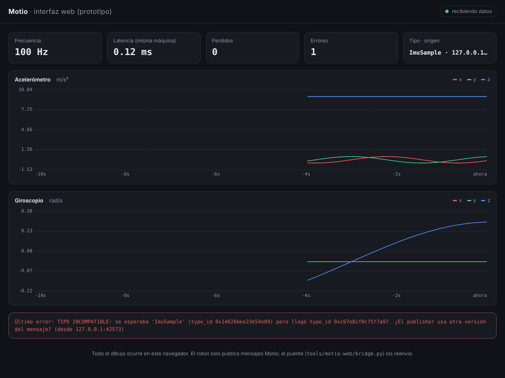

# Motio

> *Motio* (latín): movimiento.

Motio es un framework para **robótica + IA + IoT** que se construye desde cero
como alternativa a ROS 2. Su núcleo es el **sistema nervioso** del robot:
mueve mensajes entre nodos de forma rápida, confiable y con marca de tiempo.
La IA, la visión y el IoT **no viven dentro del núcleo**: se conectan a él
como paquetes opcionales.

- Núcleo en **C++20**; corre en **Windows, Linux y macOS** (verificado por CI).
- **Python de primera clase** y la compatibilidad vive en el formato de
  mensajes, no en un lenguaje.
- **Interfaz web**: el robot solo publica datos y el navegador (laptop,
  celular o nube) hace todo el trabajo visual.

📄 **Lee primero:** [`docs/VISION.md`](docs/VISION.md) (visión, decisión de
C++, comparación con dora-rs, roadmap),
[`docs/rfc/0001-formato-de-mensajes.md`](docs/rfc/0001-formato-de-mensajes.md)
(formato v1 propuesto) y
[`docs/rfc/0002-interfaz-web.md`](docs/rfc/0002-interfaz-web.md) (interfaz web).

## Estado: Nivel 0 ✅

| Nivel | Tema |
|---|---|
| **0 ✅** | **Fundamentos: serialización, UDP, seq, latencia, CI + prototipo de interfaz web** |
| 1 ⏭ | Sobre v1 + codificación `compact` + esquema en texto + decodificación dinámica |
| 2–13 | Ver [`docs/VISION.md`](docs/VISION.md#7-roadmap-por-niveles) |

## Estructura

```
motio/
├── include/motio/           API pública: motio.hpp, wire.hpp, net.hpp, platform.hpp
├── src/                     implementación del núcleo
├── examples/nivel0/         publisher y subscriber
├── tests/                   pruebas (ctest)
├── tools/motio-web/         interfaz web (prototipo): bridge.py + index.html
├── python/motio/            implementación de referencia en Python (import motio)
├── scripts/                 interop.py (C++ <-> Python), web_smoke.py
├── bench/                   mediciones que respaldan decisiones de diseño
├── docs/                    VISION, PROTOCOLO (v0), rfc/
└── .github/workflows/ci.yml CI: Windows (MSVC), Linux (GCC + sanitizers), macOS (Clang)
```

## Requisitos

| Sistema | Compilador + CMake | Python |
|---|---|---|
| **Windows** | [Visual Studio 2022 Community](https://visualstudio.microsoft.com/) con la carga de trabajo **"Desarrollo para el escritorio con C++"** (trae CMake) | 3.10+ desde python.org (comando `python` o `py`) |
| **Linux** (Ubuntu/Debian) | `sudo apt install build-essential cmake` (GCC 11+) | `python3` (ya viene) |
| **macOS** | `xcode-select --install` y `brew install cmake` | `python3` |

Se necesita un compilador con C++20: GCC 11+, Clang 14+ o MSVC 2022.

## Compilar y probar

Mismos comandos en PowerShell (Windows) y en la terminal de Linux/macOS (en
Windows usa `python` en vez de `python3`):

```bash
cmake -S . -B build
cmake --build build --config Release
ctest --test-dir build -C Release           # pruebas de C++
python3 -m unittest discover -s python      # pruebas de Python
python3 scripts/interop.py                  # C++ <-> Python
```

> Con Visual Studio también puedes usar **Archivo → Abrir → Carpeta** y elegir
> `motio/`: detecta el `CMakeLists.txt` solo.

Los ejecutables quedan en `build/bin/` (en Windows, `build\bin\publisher.exe`).

## Correr el Nivel 0

```bash
# Terminal 1
./build/bin/subscriber
# Terminal 2
./build/bin/publisher --rate 100
```

Cada segundo el subscriber imprime algo así:

```
[subscriber] rx=  100 perdidos=0  desordenados=0  errores=0  latencia µs: min=28 prom=60 p99=138 max=345
```

Mezclando lenguajes:

| Terminal 1 | Terminal 2 | Resultado |
|---|---|---|
| `python3 python/subscriber.py` | `./build/bin/publisher` | C++ publica, Python escucha |
| `./build/bin/subscriber` | `python3 python/publisher.py` | Python publica, C++ escucha |

## Interfaz web (prototipo)

```bash
python3 tools/motio-web/bridge.py           # Terminal 1: el puente
./build/bin/publisher --rate 100            # Terminal 2: el "robot"
# Abre http://127.0.0.1:8080
```



Muestra en vivo el acelerómetro y el giroscopio, la frecuencia, la latencia,
las pérdidas y los errores. Para verla **desde el celular** en la misma red WiFi:

```bash
python3 tools/motio-web/bridge.py --http 0.0.0.0:8080   # luego abre http://IP-DE-TU-PC:8080
```

⚠ El prototipo no tiene contraseña: úsalo solo en tu red local. El diseño
completo (WebSocket, teleoperación, modo nube con autenticación) está en el
RFC 0002.

## Usar Motio en tu propio proyecto CMake

```cmake
add_subdirectory(ruta/a/motio)
target_link_libraries(mi_nodo PRIVATE motio::core)
```

```cpp
#include <motio/motio.hpp>

auto bytes = motio::wire::encode(motio::wire::ImuSample{...}, seq, motio::wire::now_ns());
```

## Qué aprendes en el Nivel 0

| Concepto | Dónde verlo |
|---|---|
| Serialización little-endian portable | `include/motio/wire.hpp` → `put_le` / `get_le` |
| Hash del esquema calculado en compilación | `fnv1a64` (`constexpr`) y `static_assert` en `tests/test_wire.cpp` |
| Errores claros en vez de fallas silenciosas | `motio::wire::WireError` |
| Sockets en Windows vs Linux/macOS | `src/net.cpp` (Winsock vs BSD) |
| Por qué el sleep en Windows es impreciso y cómo arreglarlo | `src/platform.cpp` |
| Lazo a frecuencia fija sin acumular error | `examples/nivel0/publisher.cpp` (programación por *deadline*) |
| Detección de pérdidas con números de secuencia | `examples/nivel0/common.hpp` → `SeqTracker` |

## Ejercicios

1. Dibuja a mano los 56 bytes de un `ImuSample` y compáralos con la prueba `layout_del_header_es_estable`.
2. **Provoca un error de tipo:** agrega `;f32 temp` al `SCHEMA` en `python/motio/wire.py`, corre `python/publisher.py` contra el subscriber de C++ y mira el error en la terminal **y en la interfaz web**.
3. **Satura el sistema:** sube `--rate` (1000, 10000, 50000) y observa la latencia, los `perdidos` y los `retrasos`.
4. **Pruébalo en red:** subscriber o puente web en otra PC con `--listen 0.0.0.0:7400`, publisher con `--to IP:7400`.
5. Corre `python3 bench/arrow_vs_compact.py` (`pip install pyarrow numpy`) y relaciónalo con la sección 2 del RFC 0001.

## Contribuir

- Antes de abrir un PR: compila con `-DMOTIO_WERROR=ON` y corre las pruebas.
- Las decisiones de diseño grandes se proponen como RFC en `docs/rfc/`.
- La regla número uno: **nunca fallar en silencio**.
