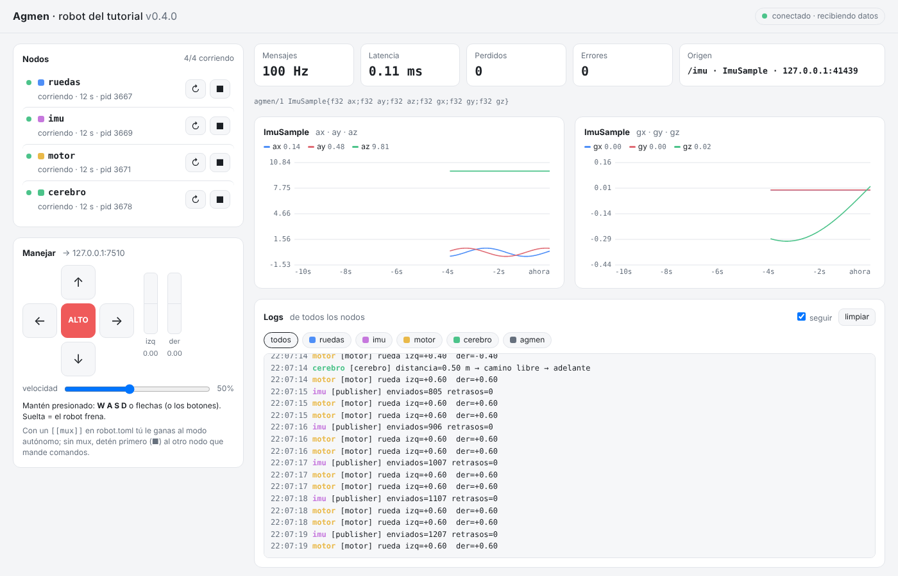

# Agmen

> *Agmen* (latín): multitud en movimiento; columna en marcha.

Agmen es un framework para **robótica + IA + IoT** que se construye desde cero
como alternativa a ROS 2. Su núcleo es el **sistema nervioso** del robot:
mueve mensajes entre nodos de forma rápida, confiable y con marca de tiempo.
La IA, la visión y el IoT **no viven dentro del núcleo**: se conectan a él
como paquetes opcionales.

- Núcleo en **C++20**; corre en **Windows y Linux, x86-64 y ARM64** como la Raspberry Pi (verificado por CI). En macOS, `pip install agmen` instala la versión de Python puro (sin soporte oficial desde 0.11.1).
- **Python de primera clase** y la compatibilidad vive en el formato de
  mensajes, no en un lenguaje. Un mensaje se describe con **una línea**
  (`Arca9Articulaciones{f32[12] q}`) y cualquier herramienta lo entiende sin
  código extra: `agmen echo` lo muestra en la terminal y el panel lo grafica.
- **Tus mensajes, una sola vez:** los escribes en un archivo `.agmen` (con
  enums, constantes y valores por defecto) y Agmen genera el código de C++
  (`agmen_add_messages` en CMake) y de Python (`agmen.load`), sin cambiar los
  bytes.
- **Topics sin configurar nada:** `Publisher("/imu")` y `Subscriber("/imu")`,
  sin IPs ni puertos, y con cuantos receptores quieras. Un pequeño `agmen hub`
  por máquina hace de directorio, sin multicast (funciona en el WiFi de la
  escuela) y sin que los datos pasen por él. `agmen topic list/info/echo/hz`
  y `agmen node list` te dejan ver el robot por dentro.
- **Un solo comando** levanta todo el robot (`agmen run robot.toml`) y un
  **panel web** lo controla: nodos, logs, varias gráficas a la vez, un
  inspector de mensajes y manejo. El robot **no dibuja ni convierte nada**: le
  manda al navegador los mismos bytes de Agmen y el navegador los decodifica.
  Ábrelo desde el celular con `--red` (con clave) o conéctate con **Foxglove**.
- **Imágenes y tensores sin copiar:** en la misma computadora, una cámara
  escribe cada imagen **una vez** en memoria compartida y la IA la recibe como
  un `numpy.ndarray` que apunta a esa misma memoria, sin cambiar tu código
  (4K con 3 suscriptores: de 21.9 ms a 5.8 ms, y la cámara gasta 11 veces
  menos CPU). Si están en computadoras distintas, va por TCP solo.
- **Tu robot como dataset:** `agmen run --record` (o el botón ⏺ del panel)
  graba todos los topics en un `.mcap` sin frenar a nadie; `agmen run --play`
  lo reproduce con su tiempo original en vez de los sensores; el panel lo
  muestra en el navegador con barra de tiempo, y `agmen export --parquet` lo
  convierte en tablas para entrenar (`agmen.Recording` en Python).
- Los nodos corren **en paralelo** (un proceso cada uno) y se mide en cada
  cambio (`scripts/paralelo_check.py`). Si el panel y un cerebro autónomo
  mandan al mismo motor, **un `[[mux]]` decide quién manda**: tú le ganas al
  modo autónomo y al soltar lo retoma solo.

**Versión actual: 0.12.0** ([CHANGELOG](CHANGELOG.md) · [política de versiones](docs/VERSIONES.md)) · Licencia MIT

| Para… | Lee |
|---|---|
| **Empezar a usarlo** | 📘 [**Tutorial**](docs/tutorial/README.md): de la instalación a un robot completo con un solo comando y panel web |
| Entender el proyecto | [`docs/VISION.md`](docs/VISION.md): visión, decisión de C++, comparación con dora-rs, roadmap |
| El formato de mensajes | [PROTOCOLO v1](docs/PROTOCOLO.md) (implementado) · [RFC 0001](docs/rfc/0001-formato-de-mensajes.md) (diseño y razones) · [vectores de prueba](tests/vectors/v1.txt) |
| La interfaz web | [RFC 0002](docs/rfc/0002-interfaz-web.md) (aceptado, implementado en 0.6.0: WebSocket, red con clave, Foxglove) · [RFC 0003](docs/rfc/0003-lanzador-y-panel.md) (`agmen run` y panel) |
| Topics y el hub | [RFC 0004](docs/rfc/0004-topics-y-descubrimiento.md) (aceptado, implementado en 0.5.0) |
| Mensajes en archivos `.agmen` | [RFC 0005](docs/rfc/0005-esquemas-agmen.md) (aceptado, implementado en 0.7.0) |
| Varias frecuencias en un nodo y el reloj de Agmen | [RFC 0006](docs/rfc/0006-executor-y-reloj.md) (aceptado, implementado en 0.8.0) |
| Python compilado desde el núcleo de C++ | [RFC 0007](docs/rfc/0007-python-compilado.md) (aceptado, implementado en 0.9.0) |
| Imágenes, tensores y texto (datos grandes) | [RFC 0008](docs/rfc/0008-datos-grandes.md) (aceptado, implementado en 0.10.0) |
| Memoria compartida: imágenes sin copiar entre procesos | [RFC 0009](docs/rfc/0009-memoria-compartida.md) (aceptado, implementado en 0.11.0; D6 a′ en 0.11.1) |
| Grabar, reproducir y exportar a Parquet | [RFC 0010](docs/rfc/0010-grabar-y-reproducir.md) (aceptado, implementado en 0.12.0) · [el perfil `agmen` de MCAP](docs/PROTOCOLO.md#grabaciones-mcap) |
| Publicar versiones | [`docs/PUBLICAR.md`](docs/PUBLICAR.md) |

## Estado

| Versión | Nivel | Tema |
|---|---|---|
| 0.1.0 ✅ | 0 | Fundamentos: serialización, UDP, seq, latencia, CI, tutorial |
| 0.2.0 ✅ | — | `agmen run robot.toml` + panel web de control (nodos, logs, sensores, manejar) |
| 0.3.0 ✅ | — | ¿Quién manda? Prioridad de comandos (teleop > autónomo) y paralelismo medido |
| 0.4.0 ✅ | 1 | Sobre v1 + codificación `compact` + esquema en texto + decodificación dinámica |
| 0.5.0 ✅ | 2 | Topics: los nodos se encuentran solos (`agmen hub`), `agmen topic list/info/echo/hz`, `agmen node list` |
| 0.6.0 ✅ | 3 | Panel por WebSocket: el navegador decodifica los bytes de Agmen, varias gráficas, inspector, celular con clave, compatible con Foxglove |
| 0.7.0 ✅ | 4 | Archivos `.agmen`: escribes tus mensajes una vez y se genera el código de C++ y de Python |
| 0.8.0 ✅ | 5 | Un nodo con varios ritmos (`Node`, `every`, grupos con su propio hilo) y el reloj de Agmen: simulación más rápida, más lenta o en pausa |
| 0.9.0 ✅ | 6 | `pip install agmen` trae el núcleo de C++ compilado: el mismo código de Python, varias veces más rápido; arreglos como NumPy sin copiar |
| 0.10.0 ✅ | 7 | Imágenes, tensores y texto: `string`, `bytes`, `T[]` y `tensor<T,N>` en tus `.agmen` (codificación `arrow`, por TCP), `agmen.msgs.Imagen`, cámara en el panel y en Foxglove |
| 0.11.0 ✅ | 8 | Memoria compartida: en la misma computadora, las imágenes y los tensores no se copian entre procesos (C++ y Python); en computadoras distintas, TCP |
| **0.12.0 ✅** | **9** | **Grabar y reproducir: `agmen record`, `agmen play` con el tiempo de la grabación, el `.mcap` en el panel (barra de tiempo) y en Foxglove, y `agmen export --parquet` / `agmen.Recording` para entrenar** |
| … | 10–14 | Ver [`docs/VISION.md`](docs/VISION.md#7-roadmap-por-niveles) |

## Estructura

```
agmen/
├── VERSION                  la versión (fuente única de verdad)
├── CHANGELOG.md · LICENSE · pyproject.toml (pip install agmen)
├── include/agmen/           API pública: agmen.hpp, wire.hpp, arrow.hpp, net.hpp, shm.hpp, node.hpp, clock.hpp, msgs.hpp (Imagen)
├── src/                     implementación del núcleo
├── examples/nivel0/         publisher y subscriber
├── examples/tutorial/       código del tutorial (motor, controlador, cerebro.py, dataset.py)
├── examples/nodos/          un nodo con dos ritmos y el reloj de Agmen (capítulo 12)
├── examples/vision/         una cámara, una IA que la mira y un contador en C++ (capítulos 14 y 15)
├── tests/                   pruebas (ctest)
├── examples/tutorial/robot.toml  el robot del tutorial completo, para `agmen run`
├── python/agmen/            paquete de Python: import agmen + el comando `agmen`; msgs.agmen (Imagen)
├── python/src/core.cpp      agmen._core: el núcleo de C++ para Python (nanobind)
│   ├── run.py               agmen run: lanzador y supervisor de nodos
│   ├── mux.py               agmen mux: prioridad de comandos (¿quién manda?)
│   ├── hub.py · hubproto.py agmen hub: el directorio de topics (RFC 0004)
│   ├── topic.py             agmen topic list/info/echo/hz, agmen node list
│   ├── _tcp.py · _shm.py    mensajes grandes por TCP y por memoria compartida (RFC 0008, 0009)
│   ├── _mcap.py             lector y escritor de MCAP, sin dependencias (RFC 0010)
│   ├── record.py · play.py  agmen record / info y agmen play
│   ├── recording.py         agmen.Recording y agmen export (Parquet, Foxglove)
│   ├── idl.py · gen.py      archivos .agmen y agmen gen (RFC 0005)
│   ├── ws.py                WebSocket con la librería estándar
│   └── panel/               panel web: servidor, puente (bridge.py), agmen.js, mcap.js (grabaciones) y la página
├── cmake/                   AgmenMessages.cmake: agmen_add_messages()
├── scripts/                 interop, web, foxglove, run, grabar, paralelo, topics, gen, tutorial y check_version (todos corren en el CI)
├── bench/                   mediciones que respaldan decisiones de diseño (shm_vs_tcp.py: RFC 0009; grabar.py: RFC 0010)
├── docs/                    tutorial/, VISION, PROTOCOLO, VERSIONES, PUBLICAR, rfc/
└── .github/workflows/       ci.yml (3 sistemas, ARM incluido, + sanitizers y fuzzing) · release.yml (PyPI + GitHub Release)
```

## Requisitos

| Sistema | Compilador + CMake | Python |
|---|---|---|
| **Windows** | [Visual Studio 2022 Community](https://visualstudio.microsoft.com/) con la carga de trabajo **"Desarrollo para el escritorio con C++"** (trae CMake) | 3.11+ desde python.org (comando `python` o `py`) |
| **Linux** (Ubuntu/Debian) | `sudo apt install build-essential cmake` (GCC 11+) | `python3` (ya viene) |

Se necesita un compilador con C++20: GCC 11+, Clang 14+ o MSVC 2022.

**macOS** no tiene soporte oficial desde 0.11.1: el código es POSIX y se
compiló y probó ahí hasta 0.11.0, pero ya no se prueba en el CI ni hay wheels
compiladas. `pip install agmen` instala la versión de Python puro.

Solo para **usar** Agmen desde Python no hace falta nada de esto:
`pip install agmen` (Python 3.11+) ya trae el núcleo de C++ compilado.
Para compilar también el núcleo de Python en el repositorio:
`pip install nanobind` antes de configurar con CMake.

## Compilar y probar

Mismos comandos en PowerShell (Windows) y en la terminal de Linux (en
Windows usa `python` en vez de `python3`):

```bash
cmake -S . -B build
cmake --build build --config Release
ctest --test-dir build -C Release           # pruebas de C++
python3 -m unittest discover -s python      # pruebas de Python
python3 scripts/interop.py                  # C++ <-> Python
pip install .                               # el paquete de Python y el comando `agmen`
```

> Con Visual Studio también puedes usar **Archivo → Abrir → Carpeta** y elegir
> `agmen/`: detecta el `CMakeLists.txt` solo.

Los ejecutables quedan en `build/bin/` (en Windows, `build\bin\publisher.exe`).

## Correr el Nivel 0

```bash
# Terminal 1
./build/bin/subscriber
# Terminal 2
./build/bin/publisher --rate 100
```

Cada segundo el subscriber imprime algo así:

```
[subscriber] rx=  100 perdidos=0  desordenados=0  errores=0  latencia µs: min=28 prom=60 p99=138 max=345
```

Mezclando lenguajes:

| Terminal 1 | Terminal 2 | Resultado |
|---|---|---|
| `python3 python/subscriber.py` | `./build/bin/publisher` | C++ publica, Python escucha |
| `./build/bin/subscriber` | `python3 python/publisher.py` | Python publica, C++ escucha |

## Todo el robot con un solo comando

En vez de abrir una terminal por nodo, describe tu robot en un archivo:

```toml
[robot]
name = "mi robot"
before = ["cmake --build build"]          # compila antes de arrancar

[[node]]
name = "motor"
cmd = "./build/bin/motor"                 # escucha el topic /cmd
restart = "on-failure"                    # si se cae, se levanta solo

[[node]]
name = "cerebro"
cmd = "python cerebro.py"

[web.teleop]
target = "/cmd"                           # manejar el robot desde el panel
```

```bash
agmen run robot.toml        # prueba: agmen run examples/tutorial/robot.toml
```

Arranca todos los nodos, junta sus logs en una terminal (un color por nodo),
los reinicia si fallan y abre el **panel web**:



- **Nodos:** estado de cada uno, con botones ▶ iniciar, ■ detener y ↻ reiniciar.
- **Manejar:** W A S D, flechas o botones táctiles. Al soltar, el robot frena.
- **Datos:** gráficas en vivo de **cualquier** mensaje (se arman solas a partir de su esquema), de varios topics a la vez; Hz, latencia, pérdidas y errores.
- **Mensaje:** el inspector muestra el último mensaje del topic elegido, campo por campo.
- **Logs:** todos los nodos en un lugar, con filtros.
- **¿Quién manda?** Con `[[mux]]`, lo que mandas desde el panel le gana al
  cerebro autónomo ([capítulo 6](docs/tutorial/06-quien-manda.md)).

Ctrl+C detiene todo de forma ordenada. Para abrirlo **desde el celular**:
`agmen run robot.toml --red` e imprime un link con clave. Si se corta la señal
mientras manejas, el panel manda ALTO. **Foxglove** se conecta a
`ws://127.0.0.1:8080/ws` (solo lectura).

⚠ La clave del modo red viaja sin cifrar: no lo expongas a internet. Detalles
y referencia completa de `robot.toml` en el [RFC 0003](docs/rfc/0003-lanzador-y-panel.md)
y en los capítulos [5](docs/tutorial/05-un-solo-comando.md) y
[10](docs/tutorial/10-panel-celular-y-foxglove.md) del tutorial.

## Usar Agmen en tu propio proyecto CMake

```cmake
add_subdirectory(ruta/a/agmen)
target_link_libraries(mi_nodo PRIVATE agmen::core)
```

```cpp
#include <agmen/agmen.hpp>

agmen::Publisher<agmen::wire::ImuSample> pub("/imu");     // un topic (o "127.0.0.1:7400")
pub.publish(agmen::wire::ImuSample{.accel = {0, 0, 9.81f}});

agmen::Subscriber<agmen::wire::ImuSample> sub("/imu");
if (auto s = sub.receive(std::chrono::milliseconds(50))) { /* s->message, s->envelope */ }
```

Para tus propios tipos de mensaje, escríbelos en un archivo `.agmen` y CMake
genera el header:

```cmake
agmen_add_messages(mi_robot_msgs mensajes/arca9.agmen)
target_link_libraries(mi_nodo PRIVATE mi_robot_msgs)      # #include "arca9.hpp"
```

En Python, `msgs = agmen.load("mensajes/arca9.agmen")`. Todo en el
[capítulo 11 del tutorial](docs/tutorial/11-mensajes-agmen.md).

## Qué aprendes en los niveles 0 y 1

| Concepto | Dónde verlo |
|---|---|
| Serialización little-endian portable | `include/agmen/wire.hpp` → `put_le` / `get_le` |
| Hash del esquema calculado en compilación | `fnv1a64` (`constexpr`) y `static_assert` en `tests/test_wire.cpp` |
| Errores claros en vez de fallas silenciosas | `agmen::wire::WireError` |
| Sockets en Windows vs Linux | `src/net.cpp` (Winsock vs BSD) |
| Por qué el sleep en Windows es impreciso y cómo arreglarlo | `src/platform.cpp` |
| Lazo a frecuencia fija sin acumular error | `examples/nivel0/publisher.cpp` (programación por *deadline*) |
| Detección de pérdidas con números de secuencia | `examples/nivel0/common.hpp` → `SeqTracker` |
| Un parser que corre **al compilar** (valida el esquema y calcula su tamaño) | `agmen::wire::schema::check` en `include/agmen/wire.hpp` |
| Layout de un struct de C: alineación y relleno | `python/agmen/schema.py` → `Layout` |
| Decodificar cualquier tipo sin código compilado | `agmen echo` (`python/agmen/echo.py`) y el panel (`python/agmen/panel/agmen.js`, en el navegador) |
| Dos implementaciones, los mismos bytes | `tests/vectors/v1.txt`, revisado por C++ y por Python |
| Memoria compartida en Windows y Linux, y quién suelta cada bloque | `src/shm.cpp` (`shm_open` vs `CreateFileMappingW`) y `src/pubsub.cpp` (préstamos que se devuelven por TCP) |

## Ejercicios

1. Dibuja a mano los 88 bytes de un `ImuSample` y compáralos con la prueba `layout_del_sobre_es_estable`.
2. **Provoca un error de tipo:** agrega `;f32 temp` al `SCHEMA` de `ImuSample` en `python/agmen/wire.py`, corre `python/publisher.py` contra el subscriber de C++ y mira cómo el error te dice qué esquema llegó.
3. **Satura el sistema:** sube `--rate` (1000, 10000, 50000) y observa la latencia, los `perdidos` y los `retrasos`.
4. **Pruébalo en red:** subscriber o puente web en otra PC con `--listen 0.0.0.0:7400`, publisher con `--to IP:7400`.
5. Corre `python3 bench/arrow_vs_compact.py` (`pip install pyarrow numpy`) y relaciónalo con la sección 2 del RFC 0001.
6. Corre `python3 bench/shm_vs_tcp.py --rapido` y explica, con la tabla del RFC 0009 §1.1, por qué TCP gasta más CPU con 3 suscriptores y la memoria compartida casi no.

## Contribuir

- Antes de abrir un PR: compila con `-DAGMEN_WERROR=ON` y corre las pruebas.
- Las decisiones de diseño grandes se proponen como RFC en `docs/rfc/`.
- La regla número uno: **nunca fallar en silencio**.
