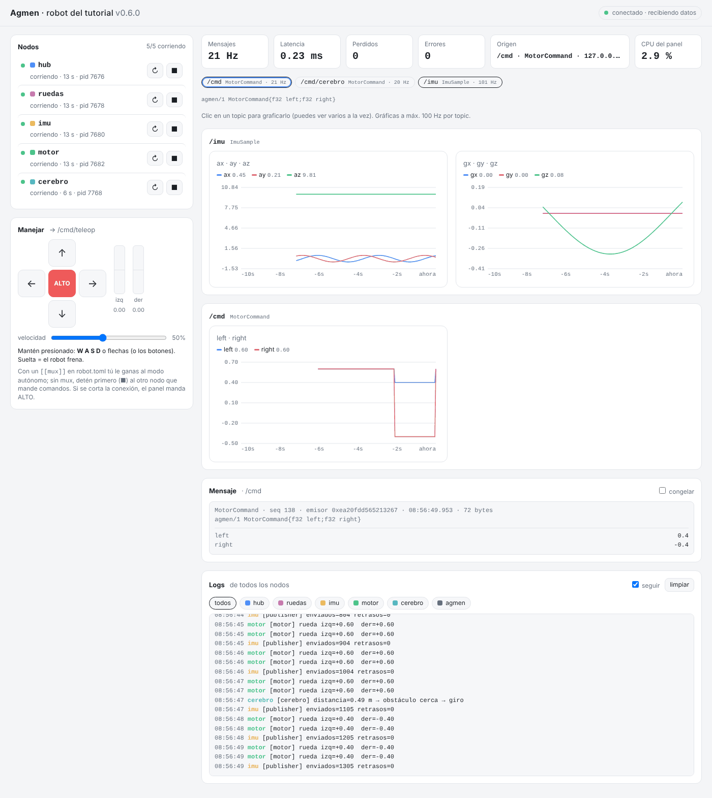

# RFC 0002 — Interfaz web de Agmen (`agmen-web`)

| | |
|---|---|
| **Estado** | ✅ **Aceptado** (2026-11-03) e **implementado en Agmen 0.6.0** (nivel 3). Decisiones en la [sección 4](#4-decisiones-aprobadas). Prototipo previo: 0.2.0 |
| **Fecha** | 2026-10-30 (propuesta) · 2026-11-03 (aceptado) |
| **Relacionado** | RFC 0001 (formato que decodifica el navegador), RFC 0003 (`agmen run` y el panel), RFC 0004 (topics) |

## 1. Problema

En ROS 2, la interfaz gráfica (RViz, rqt) es una aplicación de escritorio
pesada. Normalmente corre en la misma computadora del robot y compite con el
control, la percepción y la IA por CPU, GPU y memoria. En un robot pequeño (una
Raspberry Pi, una Jetson) eso es un lujo que no te puedes dar. Además, para
verla necesitas instalar ROS en la máquina desde donde miras.

## 2. Idea

**El robot no dibuja nada.** Solo publica mensajes de Agmen, como siempre. Un
**puente** reenvía esos mensajes a un **navegador web**, y el navegador hace
todo el trabajo visual: gráficas, video, 3D.

```
 ROBOT (Raspberry, Jetson, PC)                         CUALQUIER PANTALLA
┌──────────────────────────────┐                     ┌─────────────────────┐
│ nodos ──► Agmen ──► puente   │ ── WebSocket ─────► │ navegador (laptop,  │
│ (ESP32 vía agente)           │   (bytes de Agmen)  │ celular, tablet)    │
└──────────────────────────────┘                     │  · gráficas         │
                         │                           │  · inspector        │
                         │  foxglove.websocket.v1    │  · teleoperación    │
                         └─────────────────────────► │ Foxglove/Lichtblick │
                                                     └─────────────────────┘
```

- El robot gasta lo mismo que si le mandara datos a otro nodo: copia bytes.
  Medido en el CI (`scripts/web_smoke.py`): ~20 % de un núcleo reenviando
  1000 mensajes/s a 3 navegadores que lo reciben todo; unos pocos % con el
  robot del tutorial (100 Hz).
- El microcontrolador nunca participa: habla con el agente, como siempre.
- Para ver la interfaz no se instala nada: solo se abre una URL.

## 3. Tres modos de uso

| Modo | Dónde corre el puente | Quién lo ve | Estado |
|---|---|---|---|
| **Local** | En la misma computadora | Esa computadora | ✅ 0.2.0 |
| **Red local** | En el robot, o en tu laptop si el robot le manda los datos | Cualquier equipo de la misma red, **con clave** | ✅ 0.6.0 (`--red`) |
| **Nube** | En un servidor de internet (relay) | Cualquier lugar, con usuario y contraseña | Nivel 11 |

Truco del modo red local: el puente **no tiene que correr en el robot**. El
robot puede mandar sus mensajes a la laptop y el puente corre ahí. El robot
queda con costo cero de interfaz.

### Modo nube: cómo se conectará (nivel 11)

El robot **abre la conexión hacia afuera** (hacia el relay) y el navegador
también se conecta al relay. Así:

- el robot no necesita IP pública ni abrir puertos en el router (funciona
  detrás del WiFi de la escuela o de un celular compartiendo datos);
- el relay autentica a los usuarios y decide quién ve qué robot;
- todo va cifrado (WSS/TLS).

**Nunca** se expone el puente de un robot directo a internet.

## 4. Decisiones aprobadas

Aprobadas por Adán el 2026-11-03: la opción recomendada en las cuatro.

| # | Pregunta | Opciones | Elegida | Por qué |
|---|---|---|---|---|
| **D1** | ¿Qué le manda el puente al navegador? | (a) **Los bytes de Agmen tal cual; el navegador decodifica**, (b) el puente convierte a JSON | **(a)** | Para el robot es casi gratis (solo copia bytes); JSON pesaría 3–5× más y costaría CPU por mensaje y por pestaña. JavaScript es la **tercera implementación** del formato y pasa los mismos vectores que C++ y Python (regla 3: el formato es el contrato) |
| **D2** | ¿En qué lenguaje va el puente? | (a) **Python ahora, C++ cuando lleguen las cámaras (nivel 7)**, (b) C++ ahora | **(a)** | Con D1 el puente solo reenvía y descarta, y Python sobra para sensores y comandos (medido, §2). Funciona con `pip install agmen` sin compilar. El puente en C++ llega con los datos grandes (nivel 7), cuando `pip` ya pueda traer C++ compilado (nivel 6). El protocolo no cambia: el navegador no se entera |
| **D3** | Abrir el panel en la red: ¿con o sin clave? | (a) **Clave automática, como Jupyter**, (b) sin clave, solo un aviso | **(a)** | Sin clave, cualquiera en el WiFi de la escuela o de la competencia podría manejar tu robot. En `127.0.0.1` no se pide nada |
| **D4** | ¿Compatible con Foxglove? | (a) **Sí, solo lectura**, (b) todavía no | **(a)** | Lo que el panel aún no tenga (3D, nubes de puntos, layouts) se ve en Foxglove o Lichtblick, sin construirlo. Publicar desde Foxglove y el 3D (transformadas) vienen después |

**Después del roadmap:** Adán quiere un visualizador propio, "nuestro
Foxglove", para cuando Agmen esté completo (VISION, nivel 14). Mientras
tanto, el panel crece por niveles (cámara en el 7; 3D y reproducción en el 9)
y Foxglove cubre lo demás.

## 5. El protocolo `agmen.ws.v1`

Un WebSocket en el mismo puerto del panel: `ws://HOST:8080/ws`. El
subprotocolo (`Sec-WebSocket-Protocol`) elige el idioma: `agmen.ws.v1` (el
panel) o `foxglove.websocket.v1` (§5.3). Implementación: `python/agmen/ws.py`
(WebSocket con la librería estándar) y `python/agmen/panel/bridge.py`.

### 5.1 Navegador → puente (texto, JSON)

| Mensaje | Qué hace |
|---|---|
| `{"op":"subscribe","topic":"/imu","max_hz":100}` | Recibir ese topic (`"*"` = todos). `max_hz`: lo más rápido que lo quieres; `0` = todo |
| `{"op":"unsubscribe","topic":"/imu"}` | Dejar de recibirlo |
| `{"op":"teleop","left":0.5,"right":0.5}` | Manejar (`[web.teleop]`): se recorta a `max_speed` y a ~60 comandos/s |
| `{"op":"node","name":"motor","action":"restart"}` | `start` / `stop` / `restart` un nodo (con `agmen run`) |

### 5.2 Puente → navegador

| Mensaje | Cuándo |
|---|---|
| `{"op":"hello","protocol":"agmen.ws.v1","version":"0.6.0","robot":"…","session":"…"}` | Al conectar |
| `{"op":"state", …}` | Cada 0.5 s: nodos, teleoperación, estadísticas por topic, `cpu_s` del puente, clientes conectados y mensajes descartados |
| `{"op":"logs","lines":[…]}` | Cada 0.1 s si hay líneas nuevas (al conectar, las últimas 300) |
| `{"op":"error","msg":"…"}` | Una operación inválida, con el porqué |
| **binario** | **Un paquete de Agmen sin modificar** (sobre de 64 B + payload), igual que llegó por UDP |

Reglas:

- **Antes del primer dato de cada emisor llega su anuncio de esquema** (anexo
  A del RFC 0001), por la cola que nunca descarta. El navegador decodifica
  desde el primer mensaje sin conocer el tipo de antemano.
- **Submuestreo por cliente y por emisor:** con `max_hz = 100`, de un topic a
  1 kHz llega 1 de cada 10. Cada pestaña pide lo suyo.
- **Mandar nunca bloquea** (regla 12): cada conexión tiene su cola acotada
  (4 MiB). Si un celular con mala señal no da abasto, se descartan *datos*
  (se cuentan en `state.bridge.dropped`) y nunca se frena al puente ni a los
  demás navegadores.
- El navegador decodifica con `agmen.js` (`python/agmen/panel/agmen.js`):
  sobre, esquemas, layout `compact` y anuncios. `python/test_panel_js.py` lo
  compara contra Python con los vectores de `tests/vectors/v1.txt`.

### 5.3 Foxglove (`foxglove.websocket.v1`, solo lectura)

Foxglove no conoce la codificación `compact`, así que **para sus clientes, y
solo para ellos**, el puente convierte a JSON:

| Agmen | Foxglove |
|---|---|
| Cada (topic, tipo) | Un canal: `encoding = "json"`, `schemaEncoding = "jsonschema"`, `schemaName` = el nombre del tipo |
| El esquema en texto | Un JSON Schema generado de él (`schema.Layout.json_schema()`) |
| Un mensaje | `messageData` (opcode 1) con el JSON del mensaje y `t_data` como timestamp |

- `serverInfo` sin capacidades: no se publica desde Foxglove todavía.
- Se prueba en el CI con el **cliente oficial** `@foxglove/ws-protocol`
  (`scripts/foxglove_check.py`).
- Conéctate con *Open connection → Foxglove WebSocket* a
  `ws://127.0.0.1:8080/ws` (o el link `?t=…` que imprime `agmen` en modo red).
  La app web de Foxglove está en HTTPS: desde ahí el navegador solo permite
  `ws://` a `localhost`. Para otra máquina usa la app de escritorio o
  Lichtblick.

## 6. Seguridad

| Riesgo | Mitigación (0.6.0) |
|---|---|
| Alguien en tu red ve o maneja el robot | En `127.0.0.1` no se ve fuera de tu computadora. En la red (`--red`) se exige una **clave** aleatoria (o la de `[web] token`): la terminal imprime el link `http://IP:8080/?t=…`; al abrirlo queda en una cookie `HttpOnly` y `SameSite=Strict`. Sin ella: 401 |
| Una página maliciosa en tu navegador manda comandos o abre el WebSocket | Los `POST` exigen `X-Agmen: 1` y el mismo `Origin`. El WebSocket del panel exige el mismo `Origin`. Foxglove (solo lectura) se acepta desde sus páginas conocidas, `localhost` y las de `[web] allow_origins`; cualquier rechazo se avisa en los logs |
| Se cierra la pestaña o se corta la señal mientras manejas | **Hombre muerto en el puente:** si el navegador estaba mandando un comando ≠ 0 y deja de mandar 300 ms (o se cierra la conexión), el puente manda **ALTO** y lo dice en los logs. El freno por timeout del motor sigue ahí, como segunda capa |
| Un navegador manda velocidades absurdas o satura al robot | Se recorta a `max_speed` y se limita a ~60 comandos/s |
| Un navegador lento frena al robot | Colas acotadas por conexión; se descartan datos, nunca se bloquea (§5.2) |

**Antes del modo nube** (nivel 11): usuarios, permisos por robot (ver /
controlar) y TLS. La clave del modo red viaja sin cifrar: sirve para la red
del laboratorio, no para internet.

## 7. Paneles, por niveles

| Panel | Necesita | Estado |
|---|---|---|
| Gráficas en vivo + estadísticas (Hz, latencia, pérdidas, errores) | Nivel 0 | ✅ 0.1.0 |
| Lista de nodos con iniciar/detener/reiniciar + logs de todos | `agmen run` (RFC 0003) | ✅ 0.2.0 |
| Teleoperación (teclado y táctil) con *deadman* y límite de velocidad | Publicar desde el navegador | ✅ 0.2.0; a un topic en 0.5.0; hombre muerto en el puente en 0.6.0 |
| Gráficas de cualquier tipo | Esquemas en texto (RFC 0001) | ✅ 0.4.0 |
| Lista de topics, **varias gráficas a la vez**, **inspector** del último mensaje | Pub/sub + WebSocket | ✅ 0.6.0 |
| Costo del panel en CPU (tarjeta "CPU del panel") | — | ✅ 0.6.0 |
| Cámara | Codificación `arrow` / bytes comprimidos (JPEG/H.264) | Nivel 7 |
| Vista 3D (robot, TF, nube de puntos) | Transformadas + Arrow | Nivel 9+ (mientras: Foxglove) |
| Reproducir grabaciones en el navegador | Grabación | Nivel 9 |

## 8. Qué hay hoy (Agmen 0.6.0, `python/agmen/panel/`)



| Archivo | Qué es |
|---|---|
| `server.py` | HTTP (página, `/agmen.js`, `/api/state`, `POST` para scripts), clave y `Origin`; recibe Agmen de todos los topics y de `[web] listen` |
| `bridge.py` | El puente: suscripciones, submuestreo, anuncios, hombre muerto, Foxglove |
| `../ws.py` | WebSocket (RFC 6455) con solo la librería estándar |
| `agmen.js` | El formato v1 en JavaScript |
| `index.html` | El panel. Sin librerías externas: funciona sin internet (útil en competencias). Tema claro/oscuro y vista para celular |

Pruebas: `python/test_web.py` (WebSocket, submuestreo, hombre muerto, clave,
`Origin`, Foxglove), `python/test_panel_js.py` (JS = Python en los vectores),
`scripts/web_smoke.py` (con nodos reales, mide el costo) y
`scripts/foxglove_check.py` (cliente oficial de Foxglove).

## Fuentes

- Protocolo WebSocket de Foxglove (`foxglove.websocket.v1`): <https://github.com/foxglove/ws-protocol> (el repositorio de las librerías está archivado; el protocolo v1 lo siguen usando el servidor y el cliente del SDK de Foxglove: <https://docs.rs/crate/foxglove/0.19.0/source/src/protocol.rs>)
- Lichtblick, el fork libre de Foxglove Studio: <https://github.com/lichtblick-suite/lichtblick>
- WebSocket: RFC 6455 <https://www.rfc-editor.org/rfc/rfc6455>
