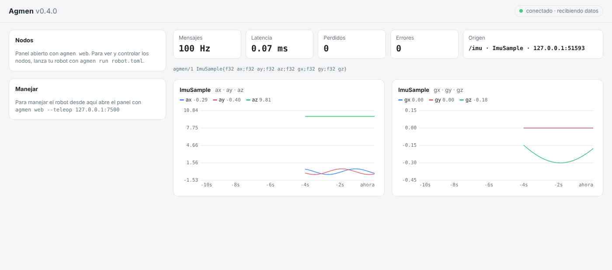
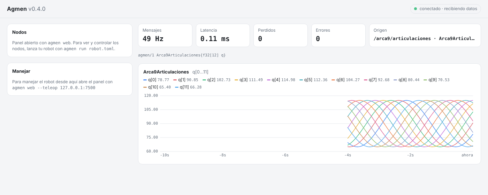

# Capítulo 4 — La interfaz web

*Disponible desde Agmen 0.1.0 · actualizado para 0.4.0 · ⏱ 10 minutos*

En ROS, la interfaz gráfica (RViz) es un programa pesado que normalmente
corre en la misma computadora del robot. En Agmen, **el robot no dibuja
nada**: el **panel** reenvía los mensajes al **navegador**, y el navegador
(en tu laptop o en tu celular) hace todo el trabajo visual.

```
 robot / tu PC                                  cualquier pantalla
 publisher ──► panel (agmen web) ── http ──► navegador: gráficas, estadísticas
```

Necesitas el comando `agmen`, que se instala con el paquete de Python del
capítulo 3 (`pip install .` desde la carpeta del repo).

## 1. Córrelo

Terminal 1, el panel:
```bash
agmen web
```
```
[agmen web] recibiendo Agmen en udp://127.0.0.1:7400
[agmen web] abre http://127.0.0.1:8080 en tu navegador
```

Terminal 2, el sensor del capítulo 1:
```bash
./build/bin/publisher --rate 100
```

Se abre solo **http://127.0.0.1:8080**:



| Elemento | Qué muestra |
|---|---|
| Frecuencia | Mensajes por segundo que están llegando |
| Latencia | Cuánto tarda cada mensaje (válido si todo corre en la misma PC) |
| Perdidos / Errores | Lo mismo que el subscriber del capítulo 1, pero visual |
| Origen | Topic, tipo y quién manda (`/imu · ImuSample · 127.0.0.1:51234`), y abajo el esquema completo |
| Gráficas | Los últimos 10 segundos de **cada campo** del mensaje, con su valor actual. El panel arma las gráficas solo, a partir del esquema: junta `ax ay az`, `gx gy gz`, los arreglos (`q[0…11]`) y los structs anidados |

## 2. Velo desde tu celular

Con la PC y el celular **en la misma red WiFi**:

```bash
agmen web --red
```

La terminal imprime un link como `http://192.168.1.20:8080/?t=5qb9IHV2pAIk`:
ábrelo en el celular. El final (`?t=…`) es la **clave** del panel: sin ella
nadie más en tu red puede verlo (Agmen 0.6, capítulo 10).

⚠ La clave viaja sin cifrar: úsalo en la red del laboratorio, no lo expongas
a internet. La versión con usuarios, cifrado y modo nube está diseñada en el
[RFC 0002](../rfc/0002-interfaz-web.md).

## 3. Experimentos

🧪 **Detén el publisher.** El indicador de arriba a la derecha cambia a
"sin datos".

🧪 **Detén el panel** (Ctrl+C en la terminal 1): la página dice "sin
conexión con Agmen · reintentando…". Vuelve a correrlo: se reconecta solo.

🧪 **Corre dos publishers a la vez** (dos terminales con `./build/bin/publisher`).
La interfaz no mezcla sus datos: grafica uno solo y muestra un aviso
amarillo, "⚠ 2 emisores mandan al mismo puerto". En un robot real eso suele
ser un error de configuración, y Agmen no lo esconde.

🧪 **Manda un tipo que el panel nunca ha visto.** Detén el publisher y corre
el cerebro del capítulo 3 apuntando al panel:
```bash
python3 examples/tutorial/cerebro.py --destino 127.0.0.1:7400
```
Sin cambiar nada del panel, aparece una gráfica nueva con `left` y `right`
del `MotorCommand`. Funciona porque el cerebro **anuncia** su esquema una vez
por segundo (capítulo 8). Lo mismo pasará con los 12 ángulos de tu robot o
con cualquier mensaje que inventes.



## Limitaciones de esta versión

- Si hay varios emisores en el mismo topic, sigue a uno y te avisa. Desde
  Agmen 0.6 puedes graficar varios topics a la vez (capítulo 10).
- Con `agmen web` el panel solo **muestra**. En el capítulo 5 lo usas con
  `agmen run` para además **controlar los nodos y manejar el robot**.

## Lo que aprendiste

- La interfaz vive en el navegador, no en el robot.
- El mismo diseño sirve en tu PC, en tu red local y, en el futuro, en la nube.

---

**Siguiente:** [Capítulo 5 — Todo el robot con un solo comando](05-un-solo-comando.md)
