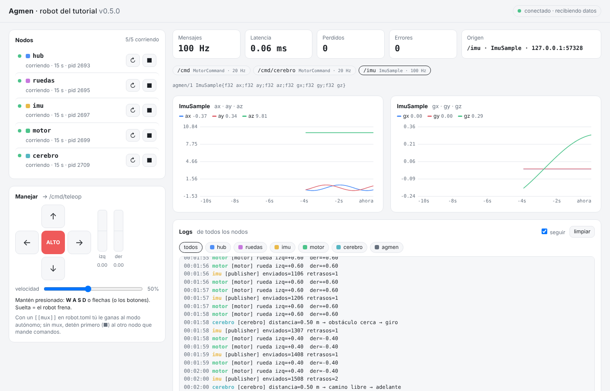

# Capítulo 5 — Todo el robot con un solo comando

*Disponible desde Agmen 0.2.0 · ⏱ 15 minutos*

Hasta ahora necesitabas una terminal por nodo: una para el sensor, otra para
el motor, otra para el cerebro y otra para el panel. En un robot de verdad
serían diez. Con `agmen run` describes tu robot en **un archivo** y lo
levantas con **un comando**. Todo se ve y se controla desde el navegador,
incluso manejar el robot.

## 1. El archivo del robot

[`examples/tutorial/robot.toml`](../../examples/tutorial/robot.toml):

```toml
[robot]
name = "robot del tutorial"
before = ["cmake --build ../../build --config Release"]   # compila antes de arrancar

[[node]]
name = "imu"
cmd = "../../build/bin/publisher --rate 100 --to /imu"
restart = "on-failure"           # si se cae, se vuelve a levantar solo

[[node]]
name = "motor"
cmd = "../../build/bin/tutorial_motor --escuchar /cmd"
restart = "on-failure"

[[node]]
name = "cerebro"
cmd = "python cerebro.py --destino /cmd/cerebro"
autostart = false                # empieza apagado: lo prendes desde el panel

[web]
http = "127.0.0.1:8080"

[web.teleop]
target = "/cmd/teleop"           # a dónde mandar los comandos de manejo
```

💡 `/imu`, `/cmd` y `/cmd/teleop` son **topics**: nombres de flujos de datos.
Nadie escribe IPs ni puertos; los nodos se encuentran solos con el
`agmen hub` que arranca `agmen run` ([capítulo 9](09-topics.md)). El
`robot.toml` del repo trae además un `[[mux]]`, la prioridad de comandos del
[capítulo 6](06-quien-manda.md), y una lista de `[[topic]]` esperados; por
ahora puedes ignorarlos.

- Cada `[[node]]` es un programa: C++, Python o lo que sea.
- Las rutas son **relativas al archivo**, así que funciona desde cualquier carpeta.
- `python` se reemplaza por tu Python, así que el mismo archivo funciona en
  Windows, Linux y macOS.

## 2. Córrelo

Si no lo hiciste en el capítulo 3, instala Agmen para Python desde la
carpeta del repo (o `pip install agmen` cuando esté publicado):

```bash
pip install .
```

Y ahora, **una sola terminal**:

```bash
agmen run examples/tutorial/robot.toml
```

```
agmen   │ Agmen 0.5.0 · robot 'robot del tutorial' · 5 nodos · agmen hub en 127.0.0.1:7390
agmen   │ antes de arrancar: cmake --build ../../build --config Release
agmen   │ panel web: http://127.0.0.1:8080
hub     │ ▶ iniciado (pid 704)
ruedas  │ ▶ iniciado (pid 706)
imu     │ ▶ iniciado (pid 708)
motor   │ ▶ iniciado (pid 710)
agmen   │ 'cerebro' no arranca solo (autostart = false); inícialo desde el panel
agmen   │ todo arrancado. Ctrl+C para detener todo.
hub     │ [hub] ▶ 'imu' publica /imu (ImuSample)
hub     │ [hub] ▶ 'motor' escucha /cmd (MotorCommand)
motor   │ [motor] Agmen 0.5.0 · esperando MotorCommand en /cmd
imu     │ [publisher] enviados=101 retrasos=0
```

El navegador se abre solo en el panel:



## 3. Recorrido por el panel

| Sección | Qué puedes hacer |
|---|---|
| **Nodos** | Ver si cada nodo está corriendo, desde cuándo y cuántas veces se ha reiniciado. Botones **▶** iniciar, **■** detener y **↻** reiniciar. Clic en el nombre = ver solo sus logs |
| **Manejar** | Mover el robot con **W A S D** o las flechas del teclado, o con los botones (también en el celular). Las barras muestran la velocidad de cada rueda |
| **Datos** | Lo mismo del capítulo 4: Hz, latencia, pérdidas y una gráfica por grupo de campos del mensaje que llegue |
| **Logs** | Lo que imprimen **todos** los nodos, en un solo lugar, con un color por nodo |

## 4. Experimentos

🧪 **Prende el cerebro:** botón ▶ de `cerebro`. En los logs verás sus
decisiones y, en las líneas del `motor`, cómo las obedece.

🧪 **Toma el control:** maneja con **W A S D** (aunque el cerebro esté
prendido: el [capítulo 6](06-quien-manda.md) explica por qué tú ganas).
Detén el cerebro (■), suelta las teclas y en medio segundo el motor dice
`⛔ ALTO: sin comandos desde hace 0.5 s`. El freno de seguridad del capítulo
2 también te protege aquí.

🧪 **Tumba un nodo:** detén el `imu` con ■. Las gráficas se congelan y el
indicador de arriba dice "sin datos". Préndelo con ▶.

🧪 **Rompe el archivo a propósito:** cambia `name` por `nmae` en un nodo y
corre otra vez:
```
error en examples/tutorial/robot.toml: clave desconocida 'nmae' en [[node]] #1. ¿Quisiste decir 'name'?
```
Agmen no arranca nada con un archivo mal escrito, y te dice qué corregir.

🧪 **Una ruta equivocada:** cambia `tutorial_motor` por `tutorial_motr`. El
nodo aparece en rojo en el panel, y en los logs sale el mensaje "no se pudo
arrancar… ¿Compilaste el proyecto y la ruta es correcta?".

🧪 **Desde el celular:** misma red WiFi y
```bash
agmen run examples/tutorial/robot.toml --http 0.0.0.0:8080
```
Abre `http://IP-DE-TU-PC:8080` en el celular y maneja con los botones.

⚠ El panel **no tiene contraseña**: cualquiera en tu red podría manejar el
robot. Úsalo solo en redes de confianza y nunca lo expongas a internet.

🧪 **Termina todo:** Ctrl+C en la terminal. Agmen detiene cada nodo en orden:
```
agmen   │ deteniendo todos los nodos…
imu     │ ■ detenido
motor   │ ■ detenido
agmen   │ listo. ¡Hasta luego!
```

## 5. Tu propio robot

Copia `robot.toml` junto a tu proyecto del capítulo 2 y cambia los `cmd`:

```toml
[robot]
name = "mi robot"
before = ["cmake --build build"]

[[node]]
name = "motor"
cmd = "./build/motor"

[[node]]
name = "controlador"
cmd = "./build/controlador"
restart = "always"
```

La referencia completa de `robot.toml` está en el
[RFC 0003](../rfc/0003-lanzador-y-panel.md#3-formato-de-robottoml).

## Lo que aprendiste

- A describir tu robot en un archivo y levantarlo con **un comando**.
- A controlar y depurar todo **desde el navegador**: nodos, logs, sensores y manejo.
- Que Agmen te avisa claro cuando algo está mal, en el archivo o en un nodo.

---

➡ Siguiente: [Capítulo 6 — ¿Quién manda?](06-quien-manda.md)
