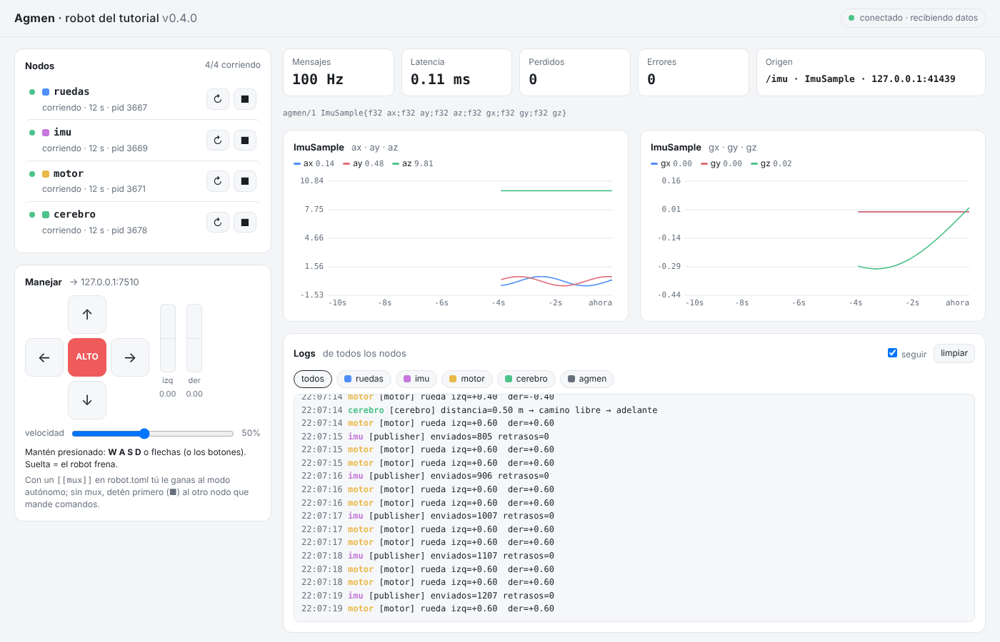

# Capítulo 5 — Todo el robot con un solo comando

*Disponible desde Agmen 0.2.0 · ⏱ 15 minutos*

Hasta ahora necesitabas una terminal por nodo: una para el sensor, otra para
el motor, otra para el cerebro y otra para el panel. En un robot de verdad
serían diez. Con `agmen run` describes tu robot en **un archivo** y lo
levantas con **un comando**. Todo se ve y se controla desde el navegador,
incluso manejar el robot.

## 1. El archivo del robot

[`examples/tutorial/robot.toml`](../../examples/tutorial/robot.toml):

```toml
[robot]
name = "robot del tutorial"
before = ["cmake --build ../../build --config Release"]   # compila antes de arrancar

[[node]]
name = "imu"
cmd = "../../build/bin/publisher --rate 100 --to /imu"
restart = "on-failure"           # si se cae, se vuelve a levantar solo

[[node]]
name = "motor"
cmd = "../../build/bin/tutorial_motor --escuchar /cmd"
restart = "on-failure"

[[node]]
name = "cerebro"
cmd = "python cerebro.py --destino /cmd/cerebro"
autostart = false                # empieza apagado: lo prendes desde el panel

[web]
http = "127.0.0.1:8080"

[web.teleop]
target = "/cmd/teleop"           # a dónde mandar los comandos de manejo
```

💡 `/imu`, `/cmd` y `/cmd/teleop` son **topics**: nombres de flujos de datos.
Nadie escribe IPs ni puertos; los nodos se encuentran solos con el
`agmen hub` que arranca `agmen run` ([capítulo 9](09-topics.md)). El
`robot.toml` del repo trae además un `[[mux]]`, la prioridad de comandos del
[capítulo 6](06-quien-manda.md), una lista de `[[topic]]` esperados y una
tarjeta de botones (`[[web.command]]`, [capítulo 10](10-panel-celular-y-foxglove.md));
por ahora puedes ignorarlos.

- Cada `[[node]]` es un programa: C++, Python o lo que sea.
- Las rutas son **relativas al archivo**, así que funciona desde cualquier carpeta.
- `python` se reemplaza por tu Python, así que el mismo archivo funciona en
  Windows y Linux.

## 2. Córrelo

Si no lo hiciste en el capítulo 3, instala Agmen para Python desde la
carpeta del repo (o `pip install agmen` cuando esté publicado):

```bash
pip install .
```

Y ahora, **una sola terminal**:

```bash
agmen run examples/tutorial/robot.toml
```

```
agmen   │ Agmen 0.6.0 · robot 'robot del tutorial' · 5 nodos · agmen hub en 127.0.0.1:7390
agmen   │ antes de arrancar: cmake --build ../../build --config Release
agmen   │ panel web: http://127.0.0.1:8080/
agmen   │ Foxglove (solo ver): conéctate a ws://127.0.0.1:8080/ws
hub     │ ▶ iniciado (pid 704)
ruedas  │ ▶ iniciado (pid 706)
imu     │ ▶ iniciado (pid 708)
motor   │ ▶ iniciado (pid 710)
agmen   │ 'cerebro' no arranca solo (autostart = false); inícialo desde el panel
agmen   │ todo arrancado. Ctrl+C para detener todo.
hub     │ [hub] ▶ 'imu' publica /imu (ImuSample)
hub     │ [hub] ▶ 'motor' escucha /cmd (MotorCommand)
motor   │ [motor] Agmen 0.6.0 · esperando MotorCommand en /cmd
imu     │ [publisher] enviados=101 retrasos=0
```

El navegador se abre solo en el panel:



## 3. Recorrido por el panel

| Sección | Qué puedes hacer |
|---|---|
| **Nodos** | Ver si cada nodo está corriendo, desde cuándo y cuántas veces se ha reiniciado. Botones **▶** iniciar, **■** detener y **↻** reiniciar. Clic en el nombre = ver solo sus logs |
| **Manejar** | Mover el robot con **W A S D** o las flechas del teclado, o con los botones (también en el celular). Las barras muestran la velocidad de cada rueda |
| **¿Quién manda?** (0.13) | Qué entrada del `[[mux]]` tiene el mando, y un aviso cuando la que mandaba se calla ([capítulo 6](06-quien-manda.md)) |
| **Movimientos** (0.13) | Botones que mandan un mensaje fijo mientras los mantienes presionados ([capítulo 10](10-panel-celular-y-foxglove.md)) |
| **Datos** | Lo mismo del capítulo 4: Hz, latencia, pérdidas y una gráfica por grupo de campos del mensaje que llegue |
| **Logs** | Lo que imprimen **todos** los nodos, en un solo lugar, con un color por nodo |

## 4. Experimentos

🧪 **Prende el cerebro:** botón ▶ de `cerebro`. En los logs verás sus
decisiones y, en las líneas del `motor`, cómo las obedece.

🧪 **Toma el control:** maneja con **W A S D** (aunque el cerebro esté
prendido: el [capítulo 6](06-quien-manda.md) explica por qué tú ganas).
Detén el cerebro (■), suelta las teclas y en medio segundo el motor dice
`⛔ ALTO: sin comandos desde hace 0.5 s`. El freno de seguridad del capítulo
2 también te protege aquí.

🧪 **Tumba un nodo:** detén el `imu` con ■. Las gráficas se congelan y el
indicador de arriba dice "sin datos". Como el `robot.toml` dice
`max_gap_ms = 100` para `/imu` (desde Agmen 0.13), `agmen run` también lo
avisa, en la terminal y en el panel:
```
agmen   │ ⚠ '/imu' no llega desde hace 0.1 s (robot.toml: max_gap_ms = 100)
```
Préndelo con ▶ y dice `✔ '/imu' volvió (estuvo 4.2 s sin llegar)`. Sirve
para lo que `required = true` no ve: un nodo que sigue vivo pero dejó de
mandar (un sensor desconectado, un nodo trabado).

🧪 **Rompe el archivo a propósito:** cambia `name` por `nmae` en un nodo y
corre otra vez:
```
error en examples/tutorial/robot.toml: clave desconocida 'nmae' en [[node]] #1. ¿Quisiste decir 'name'?
```
Agmen no arranca nada con un archivo mal escrito, y te dice qué corregir.

🧪 **Una ruta equivocada:** cambia `tutorial_motor` por `tutorial_motr`. El
nodo aparece en rojo en el panel, y en los logs sale el mensaje "no se pudo
arrancar… ¿Compilaste el proyecto y la ruta es correcta?".

🧪 **Desde el celular:** misma red WiFi y
```bash
agmen run examples/tutorial/robot.toml --red
```
Abre en el celular el link que imprime la terminal (`http://IP-DE-TU-PC:8080/?t=…`)
y maneja con los botones. El `?t=…` es la clave: sin ella nadie más en tu red
puede manejar el robot (capítulo 10). Nunca lo expongas a internet.

🧪 **Termina todo:** Ctrl+C en la terminal. Agmen detiene cada nodo en orden:
```
agmen   │ deteniendo todos los nodos…
imu     │ ■ detenido
motor   │ ■ detenido
agmen   │ listo. ¡Hasta luego!
```

## 5. Tu propio robot

Copia `robot.toml` junto a tu proyecto del capítulo 2 y cambia los `cmd`:

```toml
[robot]
name = "mi robot"
before = ["cmake --build build"]

[[node]]
name = "motor"
cmd = "./build/motor"

[[node]]
name = "controlador"
cmd = "./build/controlador"
restart = "always"
```

La referencia completa de `robot.toml` está en el
[RFC 0003](../rfc/0003-lanzador-y-panel.md#3-formato-de-robottoml).

## 6. Perfiles: el mismo `robot.toml` para el robot y para simulación

*Disponible desde Agmen 0.14.0 (aún sin publicar)*

Hasta ahora, cada `[[node]]` corre siempre. Pero un robot tiene piezas que
mueven cosas de verdad (un motor, un sensor conectado a la computadora), y
quieres probar el resto sin el robot. Un **perfil** es un nombre que dice en
qué modo corre cada nodo. Así no copias el archivo: tienes uno solo.

Esta sección funciona sin simulador: la "IMU falsa" es el mismo `publisher`
de antes, con otra velocidad. El simulador de física (MuJoCo) también viene
en la versión 0.14.0: el [capítulo 17](17-simulacion-y-real.md) muestra el
mismo robot con física, con `agmen run examples/tutorial/robot.toml --sim`.

### Paso 1: el archivo

Crea `examples/tutorial/perfiles.toml`. No cambies `robot.toml`:

```toml
[robot]
name = "robot del tutorial, con perfiles"

[[node]]
name = "imu"                                   # el sensor de verdad (en el tutorial, un publicador hace de sensor)
cmd = "../../build/bin/publisher --rate 100 --to /imu"
profile = "real"

[[node]]
name = "imu"                                   # la IMU falsa: mismo nombre, otro perfil
cmd = "../../build/bin/publisher --rate 50 --to /imu"
profile = "sim"

[[node]]
name = "motor"                                 # toca el hardware: solo en real
cmd = "../../build/bin/tutorial_motor --escuchar /cmd"
profile = "real"
restart = "on-failure"

[[topic]]
name = "/imu"
type = "ImuSample"
required = true

[[topic]]
name = "/cmd"
type = "MotorCommand"
```

Lo nuevo es esto:

- `profile = "real"` dice que el nodo solo corre en el robot de verdad. Si un
  nodo no tiene `profile`, corre en todos los perfiles.
- Los dos `imu` se llaman igual. Se puede porque nunca corren juntos: uno es
  del perfil `real` y el otro del perfil `sim`.
- Los `[[topic]]` también pueden tener `profile`. Aquí no lo ponemos, así que
  `/imu` y `/cmd` se esperan en los dos perfiles.

> **Regla de seguridad:** marca con `profile = "real"` todo nodo que toque
> hardware (motores, servos, sensores conectados). Así la simulación nunca lo
> arranca, aunque se te olvide quitarlo. Un nodo de hardware sin `profile` sí
> corre en simulación, y la simulación podría mover el robot de verdad.

### Paso 2: córrelo en los dos modos

```bash
agmen run examples/tutorial/perfiles.toml
```

```
agmen │ perfil real · reloj real · no corren: imu (perfil sim)
hub   │ ▶ iniciado (pid 14045)
imu   │ ▶ iniciado (pid 14047)
...
```

El perfil `real` no muestra letrero especial, pero la terminal dice qué
nodos no corren. Ahora en simulación:

```bash
agmen run examples/tutorial/perfiles.toml --sim
```

```
agmen │ perfil sim · reloj de simulación (×1) · no corren: imu, motor (perfil real)
agmen │ reloj: simulación ×1, lo manda agmen run en /clock (pausa, paso y velocidad en el panel)
hub   │ ▶ iniciado (pid 14073)
...
```

- `--sim` es lo mismo que `--profile sim`.
- No hace falta escribir `[clock]`: el perfil `sim` ya usa el reloj de
  simulación. En el panel puedes pausarlo, dar un paso o acelerarlo.
- El motor no corre en simulación. Eso es lo que queremos.

### Paso 3: el panel y la terminal dicen en qué perfil estás

En el panel, el perfil aparece en grande, arriba:

- **SIMULACIÓN** con `--sim`.
- **REPRODUCCIÓN** con `--play` (capítulo 16).
- **PERFIL MESA** si inventas un perfil (lo vemos abajo). En amarillo, para
  que no se te olvide.

Con el perfil `real` no hay letrero, porque es lo normal. Los programas que
consultan `/api/state` del panel reciben los campos `profile` y `playing`.

### Paso 4: más de un perfil

Puedes cambiar el perfil por defecto en `robot.toml`:

```toml
[robot]
name = "robot del tutorial, con perfiles"
profile = "sim"                  # sin --sim ni --profile, corre el perfil sim
```

Y puedes cambiar algo solo en un perfil. Por ejemplo, el panel de la
simulación en otro puerto, para no chocar con el robot de verdad:

```toml
[profile.sim.web]
http = "127.0.0.1:8098"          # en simulación, el panel usa este puerto
```

Lo que pones en `[profile.X]` reemplaza lo de arriba, pero solo en ese
perfil. Las claves que puedes poner ahí son `clock`, `web`, `record` y `local`.
Con `local = true`, todo corre en esta computadora, aunque un nodo diga
`machine` (lo vemos en la [sección 7](#7-decir-en-qué-computadora-corre-cada-nodo-machine)).

Un perfil puede tener cualquier nombre (letras sin acento, números, `_` o
`-`). Por ejemplo, el robot sobre la mesa, sin ruedas. Pon `profile = "mesa"`
en los nodos que quieras, y corre:

```bash
agmen run examples/tutorial/perfiles.toml --profile mesa
```

Agmen corre los nodos de `mesa` y los que no tienen `profile`. La terminal
dice `perfil mesa · reloj real`.

### Paso 5: errores y avisos comunes

Estos son los mensajes reales que verás. Agmen no arranca nada si el error
es de archivo o de bandera, así que lo puedes corregir sin miedo.

Un perfil que no existe (`--profile mesa` sin ningún nodo `mesa`):

```
error en examples/tutorial/perfiles.toml: el perfil 'mesa' no existe en perfiles.toml. Perfiles conocidos: real, sim, replay. Un perfil existe si algún [[node]], [[mux]] o [[topic]] lo nombra en su profile, o si tiene su tabla [profile.mesa]
```

Un error de dedo (escribiste `profile = "rael"` en vez de `"real"`). Es un
aviso, no un error: si el perfil `rael` es a propósito, declara `[profile.rael]`
y el aviso desaparece.

```
agmen │ ⚠ [[node]] 'imu': profile = "rael" y ningún otro [[node]], [[mux]] o [[topic]] nombra ese perfil. ¿Quisiste decir 'real'? Así, 'imu' solo corre con --profile rael. Si el perfil es a propósito, declara [profile.rael] y este aviso se quita
```

Reproducir y simular a la vez no tiene sentido: los dos quieren mandar el reloj.

```
error: --play reproduce una grabación y --sim corre el simulador: los dos quieren mandar el reloj. Elige uno (para reproducir con otros nodos: --play ARCHIVO.mcap --profile real)
```

El perfil `replay` es solo para `--play`:

```
error: el perfil replay es el de --play: agmen run examples/tutorial/perfiles.toml --play ARCHIVO.mcap
```

Un `--skip` de un nodo que no corre en tu perfil no es error. Agmen solo te
avisa que no hace falta:

```
agmen │ --skip motor: no hace falta, 'motor' es del perfil real y no corre en el perfil 'sim'
```

Pero un `--skip` con un nombre que no existe sí es error, y te dice cuáles hay:

```
error: --skip nada: no hay un nodo con ese nombre (hay: hub, imu, motor)
```

## 7. Decir en qué computadora corre cada nodo (`[[machine]]`)

*Disponible desde Agmen 0.14.0 (aún sin publicar)*

Un robot suele tener dos computadoras. Por ejemplo, Adán tiene una laptop con
Windows y una Raspberry Pi en el robot, y las dos están en el WiFi de la
escuela. El motor debe ir en la Raspberry Pi; la IA y el panel, en la laptop.

Con `[[machine]]` le dices a Agmen qué computadoras tienes. Con `machine` en un
`[[node]]` (o en un `[[mux]]`) dices en cuál corre ese nodo. Sin `machine`, el
nodo corre donde corres `agmen run`, como hasta ahora.

### Qué funciona hoy

Con `agmen agent` en la computadora del robot, `agmen run` en tu laptop arranca
también los nodos que dicen `machine` de esa computadora. La tabla dice qué
funciona y qué **todavía no** (llega en las partes 3c y los bloques 4 y 5 del RFC 0011):

| | Hoy (0.14.0, sin publicar) |
|---|---|
| Declarar `[[machine]]` y `machine` | Sí |
| `agmen run` en la computadora de un `machine` arranca sus nodos | Sí |
| Arrancar nodos de otra computadora desde la laptop (`agmen agent`) | Sí, con una clave (ver abajo) |
| `[profile.X] local = true` (todo aquí) | Sí |
| Etiqueta de la computadora en el panel web | No (parte 3c) |
| Reconectar tras un corte; servicio de arranque automático del agente (systemd) | No (parte 3c) |
| Topics que cruzan entre computadoras (un nodo de la laptop recibe `/imu` del robot) | No (bloque 4): cada computadora tiene su propio hub |
| Medir la diferencia de reloj entre computadoras | No (bloque 5) |

### Paso 1: el archivo

Guárdalo como `examples/tutorial/robot_maquinas.toml`. Es el robot del tutorial,
con una `[[machine]]` para la Raspberry Pi:

```toml
[robot]
name = "robot del tutorial, en dos computadoras"
before = ["cmake --build ../../build --config Release"]

[[machine]]
name = "robot"                  # la Raspberry Pi del robot
host = "192.168.1.20"           # su IP: en la Pi, `hostname -I`; en Windows, `ipconfig`

[[node]]
name = "imu"
cmd = "../../build/bin/publisher --rate 100 --to /imu"
restart = "on-failure"
machine = "robot"               # corre en la Raspberry Pi
profile = "real"                # toca el sensor de verdad: nunca corre en simulación

[[node]]
name = "motor"
cmd = "../../build/bin/tutorial_motor --escuchar /cmd"
restart = "on-failure"
machine = "robot"               # corre en la Raspberry Pi
profile = "real"                # toca el motor: nunca corre en simulación

[[node]]
name = "cerebro"                # sin machine: corre donde corres agmen run
cmd = "python cerebro.py --destino /cmd/cerebro"
autostart = false

[[mux]]
name = "ruedas"
output = "/cmd"
hold_ms = 300

[[mux.input]]
name = "cerebro"
topic = "/cmd/cerebro"
priority = 1
```

Un `[[mux]]` también puede tener `machine`, igual que un nodo. Si `machine`
dice un nombre que no declaraste, `agmen run` no arranca y te dice qué falta:
escribir `machine = "robot"` sin ninguna `[[machine]]` da un error que te pide
declararla.

### Paso 2: los tres casos

**Caso 1: `agmen run` en la misma Raspberry Pi (sin laptop).** La IP de `host`
es de esta computadora, y Agmen lo sabe. Los nodos `imu` y `motor` arrancan ahí.
La terminal dice:

```
agmen   │ robot (192.168.1.20): es esta computadora; sus nodos corren aquí (imu, motor)
agmen   │ sin machine, corren en esta computadora: hub, ruedas, cerebro
```

Así corre todo el robot sin laptop, con el mismo archivo.

**Caso 2: `agmen run` en la laptop.** La IP de `host` es de otra computadora.
Agmen se conecta con el agente de la Raspberry Pi (la sección siguiente) **antes**
de arrancar nada: ni el hub, ni `before`, ni los nodos de la laptop. Los nodos
`machine = "robot"` corren en la Raspberry Pi, y los que no dicen `machine`,
en la laptop. Si la conexión falla, no arranca nada, sale con código 2 y dice
qué hacer.

**Caso 3: simulación en la laptop con `local = true`.** Agrega esto a tu archivo:

```toml
[profile.sim]
local = true
```

Con `agmen run examples/tutorial/robot_maquinas.toml --sim`, todo corre en la
laptop. Si un nodo del perfil `sim` dijera `machine`, la terminal lo dice
(aquí, el nodo `mundo` del [capítulo 17](17-simulacion-y-real.md)):

```
agmen   │ local = true: todo corre en esta computadora (se ignora machine: mundo)
```

Los nodos `imu` y `motor` son `profile = "real"`, así que en simulación no
corren, como en la sección 6.

### Arrancar los nodos del robot desde la laptop (`agmen agent`)

Adán tiene una laptop con Windows y una Raspberry Pi en el robot, y las dos
están en el WiFi de la escuela. Así arranca el robot con dos comandos, uno en
cada computadora.

Para este ejemplo, guarda el archivo de abajo como
`examples/tutorial/robot_dos.toml`. Tiene dos nodos: `imu` en la Raspberry Pi y
`cerebro` en la laptop. El motor va igual que `imu`, con `machine = "robot"`.
Las salidas que siguen son de correr este archivo en dos computadoras de
prueba; las IP y los puertos son los de Adán.

```toml
[robot]
name = "robot del tutorial, en dos computadoras"

[[machine]]
name = "robot"                  # la Raspberry Pi
host = "192.168.1.20"           # puerto por defecto: 7391

[[node]]
name = "imu"
cmd = "../../build/bin/publisher --rate 100 --to /imu"
restart = "on-failure"
machine = "robot"
profile = "real"

[[node]]
name = "cerebro"                # sin machine: corre en la laptop
cmd = "python cerebro.py --destino /cmd/cerebro"
autostart = false
```

Tiene que ser **el mismo** `robot.toml` en las dos computadoras (con `git pull`
o copiándolo). Si no dice lo mismo, `agmen run` no arranca nada y dice qué
cambiar.

**1. En la Raspberry Pi**, en la carpeta del proyecto, deja esta terminal abierta:

```
agmen agent examples/tutorial/robot_dos.toml
```

La terminal imprime esto (la primera vez crea la clave; la última línea es la
clave que vas a escribir en la laptop):

```
agmen agent │ Agmen 0.13.0 · robot 'robot del tutorial, en dos computadoras' · esta computadora es 'robot' (192.168.1.20:7391) · nodos de aquí (perfil real): imu
agmen agent │ clave creada (guardada en /home/pi/.config/agmen/agent.key): agmen run te la pide la primera vez que se conecta
agmen agent │ esperando a agmen run en 192.168.1.20:7391 · clave: haxr-9gh2-ztgz
```

La versión que aparece es la de tu instalación de Agmen.

**2. En la laptop** (Windows, PowerShell, en la misma carpeta):

```
agmen run examples/tutorial/robot_dos.toml
```

La primera vez, `agmen run` pide la clave que muestra la Pi. Se escribe sin
verla, como una contraseña. Acepta la clave con o sin guiones, y en mayúsculas
o minúsculas:

```
clave de agmen agent en 'robot' (192.168.1.20:7391); la muestra agmen agent al arrancar, en la terminal de 'robot':
```

Con la conexión aceptada, la laptop guarda la clave y sigue. Esto es lo que
imprime (se quitan algunas líneas, marcadas con `…`):

```
agmen     │ Agmen 0.13.0 · robot 'robot del tutorial, en dos computadoras' · 3 nodos · agmen hub en 127.0.0.1:7390
agmen     │ sin machine, corren en esta computadora: hub, cerebro
agmen     │ conectando con robot (192.168.1.20:7391)…
agmen     │ guardé la clave de robot en tu usuario (agmen run --forget-key robot la borra)
robot     │ sesión de 192.168.1.7: agmen hub en 127.0.0.1:7390
agmen     │ robot (192.168.1.20:7391): conectado · Agmen 0.13.0
…
agmen     │ 'cerebro' no arranca solo (autostart = false); inícialo desde el panel
agmen     │ todo arrancado. Ctrl+C para detener todo.
robot/imu │ [publisher] enviados=101 retrasos=0
```

La terminal de la Pi sigue así desde que la laptop se conecta, hasta que la
laptop se despide (salida completa, sin recortes):

```
agmen agent │ laptop 192.168.1.7 conectada · Agmen 0.13.0 · perfil real · nodos de aquí: imu
agmen │ sesión de 192.168.1.7: agmen hub en 127.0.0.1:7390
hub   │ ▶ iniciado (pid 8594)
agmen │ la laptop pidió arrancar 'imu'
imu   │ ▶ iniciado (pid 8605)
hub   │ [hub] Agmen 0.13.0 · directorio de topics en 127.0.0.1:7390 · los datos van directo entre nodos
imu   │ [publisher] Agmen 0.13.0 · agmen/1 ImuSample{f32 ax;f32 ay;f32 az;f32 gx;f32 gy;f32 gz} (schema_id 0x83b0e57da34a724d) → /imu a 100 Hz
hub   │ [hub] ▶ 'imu' publica /imu (ImuSample)
imu   │ [publisher] enviados=101 retrasos=0
imu   │ [publisher] enviados=202 retrasos=0
imu   │ [publisher] enviados=302 retrasos=0
imu   │ [publisher] enviados=403 retrasos=0
imu   │ [publisher] enviados=504 retrasos=0
imu   │ [publisher] enviados=605 retrasos=0
imu   │ [publisher] enviados=705 retrasos=0
imu   │ [publisher] enviados=806 retrasos=0
imu   │ [publisher] enviados=907 retrasos=0
imu   │ [publisher] enviados=1007 retrasos=0
agmen │ la laptop pidió detener todo
imu   │ ■ detenido
agmen agent │ la laptop (192.168.1.7) se despidió
hub   │ ■ detenido
agmen agent │ esperando a agmen run en 192.168.1.20:7391 (otra vez)
```

Los logs de `imu` llegan a la laptop con el prefijo `robot/imu │`. Los nodos
que corren en la laptop, como `cerebro`, no llevan prefijo de computadora.

Ctrl+C en la laptop detiene los nodos de **las dos** computadoras. Así termina
su terminal:

```
agmen     │ deteniendo todos los nodos…
robot     │ la laptop pidió detener todo
robot/imu │ ■ detenido
hub       │ ■ detenido
agmen     │ listo. ¡Hasta luego!
```

La Pi no se apaga: vuelve a esperar a la siguiente `agmen run`. Ctrl+C en la
Pi detiene sus nodos y cierra el agente:

```
agmen agent │ deteniendo…
agmen agent │ listo. ¡Hasta luego!
```

#### La clave: dónde queda y cómo olvidarla

- **En la Pi**: `agent.key`, en la carpeta de Agmen de tu usuario
  (`%APPDATA%\agmen\` en Windows, `~/.config/agmen/` en Linux). Solo la lee su dueño.
- **En la laptop**: `keys.toml`, en la misma carpeta de tu usuario, con una
  línea por computadora (`"192.168.1.20:7391" = "haxr-9gh2-ztgz"`). Nunca va en
  `robot.toml` ni en git.
- La laptop guarda **solo la clave que escribiste a mano**, y solo después de
  una conexión aceptada. Si la pones en la variable `AGMEN_AGENT_KEY`, no se
  guarda.
- Si pulsas Ctrl+C o Ctrl+D cuando `agmen run` te pide la clave, cancela. No
  conecta ni arranca nada, y lo dice (salida real de Ctrl+D):

  ```
  agmen │ cancelado (Ctrl+D) antes de conectarme: no arrancó nada
  ```

- Para olvidar la clave guardada de una computadora:
  `agmen run examples/tutorial/robot_dos.toml --forget-key robot`. La
  próxima vez `agmen run` te la vuelve a pedir.
- Para cambiarla, en la Pi: `agmen agent examples/tutorial/robot_dos.toml --new-key`.
  La clave anterior deja de servir. La laptop lo dice, y entonces olvida la vieja
  con `--forget-key` y vuelve a correr `agmen run`.

#### Tres errores comunes

Estos son los textos reales. Los tres hacen que `agmen run` salga con código 2
sin arrancar nada.

1. **El agente no contesta.** La Pi no está corriendo `agmen agent`, o la IP de
   `host` no es la suya:

   ```
   error: robot (192.168.1.20:7391) no contesta: ¿está corriendo agmen agent ahí? En robot: agmen agent examples/tutorial/robot_dos.toml
   ```

   Qué hacer: en la Pi, corre `agmen agent` y revisa que la IP de `host` sea la
   suya (`hostname -I` en Linux, `ipconfig` en Windows). Las dos deben estar en
   la misma red.

2. **La clave es mala.** Si la laptop tiene una clave guardada que ya no sirve
   (por ejemplo, porque corriste `agmen agent --new-key` en la Pi):

   ```
   error: robot (192.168.1.20:7391) rechazó la clave. La clave guardada ya no sirve (¿alguien corrió agmen agent --new-key?): bórrala con agmen run --forget-key robot y vuelve a correr agmen run (te pide la nueva)
   ```

   Qué hacer: corre el comando que dice el error (`--forget-key`) y vuelve a
   correr `agmen run`, que te pide la clave nueva. Si la clave viene de la
   variable `AGMEN_AGENT_KEY`, cámbiala por la que muestra la Pi.

3. **Los `robot.toml` no dicen lo mismo.** Alguien cambió un nodo en una sola
   computadora:

   ```
   error: robot: el nodo imu es distinto en su robot.toml (cmd). Haz git pull en robot (o en tu laptop): los dos robot.toml deben decir lo mismo
   ```

   Qué hacer: haz `git pull` en las dos (o copia el mismo archivo). El texto dice
   qué nodo y qué campo difieren; si hay varios, los dice todos.

> **Lo que todavía no hace (Agmen 0.14.0).**
>
> - **Los topics no cruzan entre computadoras.** El `cerebro` de la laptop no
>   recibe `/imu` de la Pi: cada computadora tiene su propio hub. Eso llega en el
>   bloque 4 del RFC 0011.
> - **No reconecta sola.** Si se corta la red, la Pi detiene sus nodos y
>   `agmen run` detiene todo y lo dice. Para volver a arrancar, corre `agmen run`
>   otra vez. La reconexión llega en la parte 3c.
> - **Una laptop a la vez** con cada agente.
> - **El panel no dice en qué computadora corre cada nodo.** La etiqueta llega en
>   la parte 3c, junto con el servicio que arranca `agmen agent` al prender la Pi.
> - **Nada de relojes.** Medir la diferencia de reloj entre computadoras llega en
>   el bloque 5.

### ¿Por qué poner la IP y no el nombre?

Si pones un nombre, como `robot.local`, Agmen le pregunta a la red en qué IP
está. Si la red no lo conoce, o no contesta en 1.5 segundos, Agmen no puede
saber si esa computadora es la tuya. Ante la duda, supone que es **otra**. Por
eso el mensaje dice `no pude resolver 'robot.local'` y te pide la IP.

Si el nombre apunta a dos direcciones, una de esta computadora y otra de fuera,
Agmen tampoco adivina: el mensaje dice que el nombre es esas dos direcciones, que
una es de aquí y la otra no, y pide poner la IP en `host`.

¿Por qué es mejor así? Un error de más (no arranca y lo dice) se arregla en un
minuto. Un motor que arranca en la computadora equivocada, no. Una IP no depende
de la red de la escuela: siempre apunta a la misma computadora. Si la Raspberry
Pi cambia de IP, cámbiala en `host`.

### ¿Por qué `profile = "real"` en el hardware?

Un motor o un sensor de verdad se marca con `profile = "real"`. Así la
simulación nunca lo arranca, aunque lo olvides. Si el motor está en la Raspberry
Pi, en el perfil `real` la laptop lo arranca a través de `agmen agent`, y solo
si el agente de la Pi está corriendo. En simulación (caso 3) ese nodo no corre.

Un nodo **sin** `profile` corre en todos los perfiles, incluida la simulación. Si
es un motor, la simulación en la laptop podría intentar moverlo. Por eso el
hardware siempre lleva `profile = "real"`.

## Lo que aprendiste

- A describir tu robot en un archivo y levantarlo con **un comando**.
- A tener un solo `robot.toml` para el robot y para simulación, con perfiles
  (`profile`, `--sim` y `--profile`), y a marcar el hardware con `profile = "real"`.
- A decir en qué computadora corre cada nodo con `[[machine]]` y `machine`, a
  arrancar los nodos de la Raspberry Pi desde tu laptop con `agmen agent` y una
  clave, y a leer lo que dice la terminal. También sabes qué todavía no hace.
- A controlar y depurar todo **desde el navegador**: nodos, logs, sensores y manejo.
- Que Agmen te avisa claro cuando algo está mal, en el archivo o en un nodo.

---

➡ Siguiente: [Capítulo 6 — ¿Quién manda?](06-quien-manda.md)
