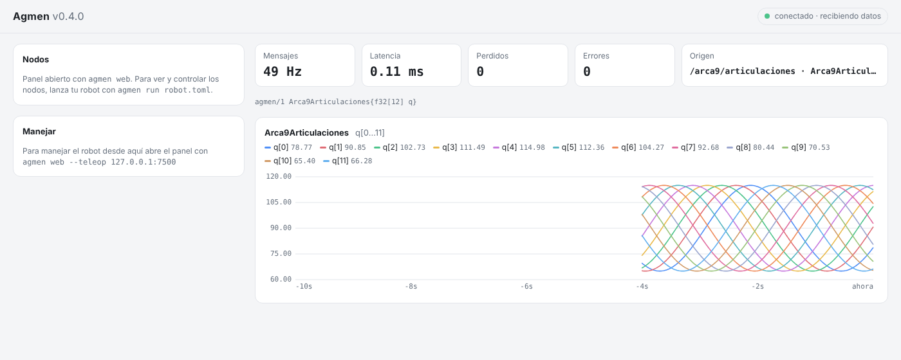

# Capítulo 8 — Tus propios mensajes y `agmen echo`

*Disponible desde Agmen 0.4.0 · ⏱ 20 minutos*

Hasta ahora usaste dos tipos de mensaje: `ImuSample` y `MotorCommand`. Un
robot de verdad necesita los suyos: los 12 ángulos de un perro robot, la
pose de un brazo, el estado de una batería. En este capítulo inventas un
tipo, lo mandas desde Python y C++, y lo ves en la terminal y en el panel
**sin que ninguna herramienta lo conozca de antemano**.

## 1. El esquema: la receta de un mensaje

Un mensaje se describe con un texto corto:

```
Arca9Articulaciones{f32[12] q}
```

Eso dice: "un mensaje `Arca9Articulaciones` con un campo `q` que es un
arreglo de 12 números `f32`". Los tipos disponibles:

| Tipo | Qué es | Bytes |
|---|---|---:|
| `bool` | verdadero / falso | 1 |
| `i8` `i16` `i32` `i64` | enteros con signo | 1, 2, 4, 8 |
| `u8` `u16` `u32` `u64` | enteros sin signo | 1, 2, 4, 8 |
| `f32` `f64` | decimales (`float`, `double` de C) | 4, 8 |
| `time` `duration` | un instante o un intervalo, en nanosegundos | 8 |
| `T[N]`, `T[N][M]` | arreglos de tamaño fijo (`f32[3][3]` = matriz 3×3) | N × T |
| `Nombre{...}` | un struct dentro de otro | lo que midan sus campos |

Ejemplos:

```
MotorCommand{f32 left;f32 right}
JointCommand7{u8 mode;f64[7] position}
Pose{Vec3{f64 x;f64 y;f64 z} p;f32 yaw}
Bateria{f32 voltaje;f32 corriente;u8 porcentaje;bool cargando}
```

De ese texto Agmen saca tres cosas:

1. **El texto canónico**, siempre igual, con espacios normalizados y el
   prefijo de la versión: `agmen/1 Pose{Vec3{f64 x;f64 y;f64 z} p;f32 yaw}`.
2. **El `schema_id`**: la "huella" de 64 bits de ese texto. Si cambias un
   solo campo, cambia la huella y los nodos viejos lo detectan.
3. **El layout en bytes**: el mismo que un `struct` de C. Cada campo se
   alinea a su tamaño, así que en `JointCommand7` el `u8 mode` ocupa el byte
   0, siguen 7 bytes de relleno (siempre en 0) y `position` empieza en el
   byte 8. Total: 64 bytes. Así un ESP32, numpy o C++ lo leen sin copiar ni
   traducir nada.

💡 Para no gastar relleno, ordena los campos de mayor a menor tamaño
(`f64` primero, `u8` y `bool` al final).

⚠ Por ahora todos los tipos son de **tamaño fijo**. Los textos (`string`),
las listas variables (`T[]`) y las imágenes llegan con la codificación
`arrow` (nivel 7).

## 2. Mándalo desde Python

```python
import math, time
from dataclasses import dataclass
import agmen
from agmen import wire

@dataclass
class Arca9Articulaciones(wire.Message):
    SCHEMA = "Arca9Articulaciones{f32[12] q}"   # en grados
    q: list

pub = agmen.Publisher(Arca9Articulaciones, "127.0.0.1:7400", topic="/arca9/articulaciones")
t0 = time.time()
while True:
    t = time.time() - t0
    pub.publish(Arca9Articulaciones([90 + 25 * math.sin(2 * t + j * 0.5) for j in range(12)]))
    time.sleep(0.02)      # 50 Hz
```

Guárdalo como `articulaciones.py`. No escribiste cómo se convierte a bytes:
Agmen lo saca del esquema.

Si te equivocas en el esquema, el error te dice qué y dónde:
```
agmen.schema.SchemaError: tipo 'float' no existe en Agmen: usa 'f32'
  Motor{float left;float right}
        ^
```

## 3. Míralo con `agmen echo`

Terminal 1:
```bash
agmen echo 127.0.0.1:7400
```

Terminal 2:
```bash
python articulaciones.py
```

```
# agmen echo · escuchando 127.0.0.1:7400, máx. 10 por segundo (--max-hz 0 = todos) · Ctrl+C para salir
# /arca9/articulaciones: agmen/1 Arca9Articulaciones{f32[12] q}  (desde 127.0.0.1:52245)
--- /arca9/articulaciones · Arca9Articulaciones · seq 0 · t_data 22:04:43.087 · 127.0.0.1:52245 · latencia 0.39 ms
  q: [90.0001, 101.986, 111.037, 114.937, 112.732, 104.962, 93.5279, 81.2304, 71.0799, 65.5617, 66.0269, 72.3615]
```

`agmen echo` nunca vio tu código. Cada `Publisher` manda una vez por segundo
un **anuncio** con el texto de su esquema, y con eso cualquier herramienta
decodifica el mensaje. En ROS 2, para hacer `echo` de un mensaje necesitas
tener instalado y compilado el paquete que lo define.

| Opción | Para qué |
|---|---|
| `--max-hz 0` | Mostrar **todos** los mensajes (por defecto, máximo 10 por segundo, para poder leer) |
| `--json` | Una línea JSON por mensaje, con el sobre completo: para guardarlo o procesarlo con un script |
| `--count 100` | Salir después de 100 mensajes |
| `--schema "Mio{f32 x}"` | Decodificar sin esperar el anuncio (por ejemplo, de un microcontrolador que no anuncia) |

Al salir (Ctrl+C) muestra un resumen (la frecuencia se cuenta desde que
abriste `echo`, no desde el primer mensaje):
```
# 149 mensajes de Arca9Articulaciones /arca9/articulaciones (36.4/s)
```

⚠ **Limitación del nivel 1:** los mensajes van a una dirección fija, así que
`echo` necesita el puerto **para él solo**. Si el panel o un nodo ya escucha
en `7400`, ciérralo o manda a otro puerto. Con topics (Agmen 0.5) podrás
escuchar sin quitarle el puerto a nadie.

## 4. Míralo en el panel

Cierra `echo` y abre el panel:

```bash
agmen web
```

Las gráficas se arman solas con tus 12 ángulos y su valor actual:



## 5. El mismo tipo en C++

```cpp
struct Arca9Articulaciones {
    static constexpr std::string_view kName = "Arca9Articulaciones";
    static constexpr std::string_view kSchema = "Arca9Articulaciones{f32[12] q}";

    std::array<float, 12> q{};

    void encode_payload(agmen::wire::Bytes& out) const {
        for (float v : q) agmen::wire::put_f32(out, v);
    }
    static Arca9Articulaciones decode_payload(agmen::wire::ByteView p) {
        Arca9Articulaciones m;
        for (std::size_t j = 0; j < 12; ++j) m.q[j] = agmen::wire::get_f32(p, 4 * j);
        return m;
    }
};
static_assert(agmen::wire::compact_size_v<Arca9Articulaciones> == 48);
```

En C++ `kSchema` va en su **forma canónica**: un solo espacio entre tipo y
nombre, `;` entre campos y sin `;` al final. Si lo escribes distinto, **no
compila**:

```
error: static assertion failed: kSchema no es un esquema canónico de Agmen. Ejemplo válido:
"MotorCommand{f32 left;f32 right}" (tipos bool i8 u8 i16 u16 i32 u32 i64 u64 f32 f64 time
duration, arreglos T[N], structs anidados Nombre{...}; un espacio entre tipo y nombre; ';'
entre campos, sin ';' final)
```

Si tu struct tiene relleno (como `JointCommand7`), escríbelo con
`agmen::wire::put_padding(out, 7)`. Si `encode_payload` no produce
exactamente los bytes que mide el esquema, Agmen lo detecta y te avisa en
vez de mandar basura.

💡 En el nivel 4 (Agmen 0.7), un generador escribirá este struct por ti a
partir del esquema.

## 6. Las dos marcas de tiempo

Cada mensaje lleva **dos** instantes, en nanosegundos:

| Campo | Qué es | Quién lo pone |
|---|---|---|
| `t_data` | A qué instante **corresponden los datos**: cuándo leyó el sensor, cuándo se tomó la foto | Tú, si lo sabes; si no, Agmen pone "ahora" |
| `t_pub` | Cuándo **se publicó** | Agmen, siempre |

La diferencia importa. Si tu IA tarda 80 ms en procesar una imagen, el
comando que publica corresponde a la imagen de hace 80 ms. Para fusionar
sensores o grabar datasets necesitas `t_data`. Para medir la latencia de la
red, `t_pub`.

```python
t_lectura = wire.now_ns()          # justo al leer el sensor
angulos = leer_servos()            # tarda un poco
pub.publish(Arca9Articulaciones(angulos), t_data=t_lectura)
```

```cpp
const auto t_lectura = agmen::wire::now_ns();
const auto angulos = leer_servos();
pub.publish(angulos, t_lectura);
```

## 7. Experimentos

🧪 **Cambia el esquema con todo corriendo:** agrega un campo
(`Arca9Articulaciones{f32[12] q;f32 voltaje}`) y vuelve a correr el script
sin cerrar `echo`. Aparece el esquema nuevo y `echo` decodifica ambos: ve
dos tipos distintos con huellas distintas.

🧪 **Mira los bytes de verdad:**
```bash
agmen echo 127.0.0.1:7400 --json --count 1
```
Verás el sobre completo: `schema_id`, `topic_id`, `source_id`, `seq`,
`t_data`, `t_pub`...

🧪 **Reinicia el emisor:** el `source_id` cambia. Así el subscriber del
capítulo 1 sabe que es otra instancia, aunque `seq` vuelva a empezar en 0.

## Lo que aprendiste

- A describir **tus propios mensajes** con un esquema de una línea.
- Que el esquema da el `schema_id`, el layout en bytes y lo necesario para
  que **cualquier herramienta** muestre tus datos sin código extra.
- A ver lo que pasa con `agmen echo` y en el panel.
- La diferencia entre `t_data` y `t_pub`.

---

🎉 **Terminaste el tutorial de Agmen 0.4.** Con la próxima versión llegan
capítulos nuevos ([índice](README.md#próximamente)).
