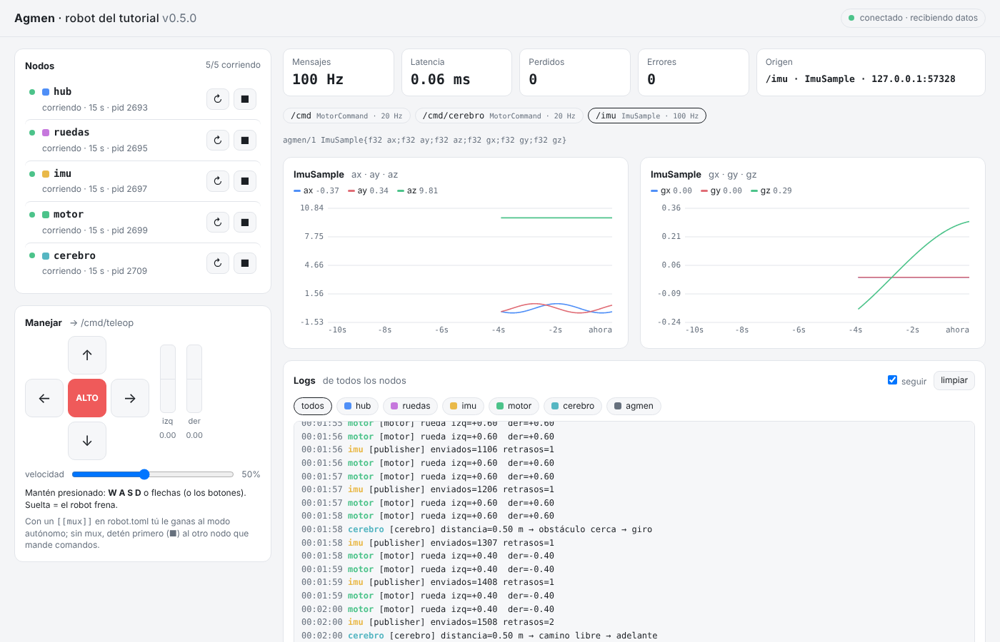

# Capítulo 9 — Topics: los nodos se encuentran solos

*Disponible desde Agmen 0.5.0 · ⏱ 15 minutos*

Hasta el capítulo 8, cada mensaje iba a una **dirección fija**: el sensor
tenía que saber que el panel estaba en `127.0.0.1:7400`, y en ese puerto
solo podía escuchar uno. Era como llamar por teléfono a un número.

Desde Agmen 0.5, los nodos hablan por **topics**: nombres de flujos de datos
como `/imu` o `/cmd`. Es como un grupo de WhatsApp: el que publica no sabe
quién escucha, y pueden escuchar todos los que quieran.

```cpp
agmen::Publisher<ImuSample> pub("/imu");      // antes: pub("127.0.0.1:7400")
agmen::Subscriber<ImuSample> sub("/imu");     // cuantos quieras
```

```python
pub = agmen.Publisher(ImuSample, "/imu")
sub = agmen.Subscriber(ImuSample, "/imu")
```

Si el texto empieza con `/`, es un topic. Si no, es una dirección, y funciona
igual que antes. El modo dirección se queda para microcontroladores y
puentes.

## 1. El hub: el directorio de la máquina

```
                 agmen hub (127.0.0.1:7390)
            "¿quién publica /imu? ¿quién lo escucha?"
               ▲ se anotan     ▲          ▲
           ┌───┴──┐       ┌────┴───┐  ┌───┴────┐
           │ imu  │ ────► │ cerebro│  │ panel  │
           │ /imu │ ──────────────► │        │
           └──────┘       └────────┘  └────────┘
              los datos van directo, sin pasar por el hub
```

- Cada nodo **se anota** en el hub ("yo publico `/imu`", "yo escucho
  `/imu`") y le manda un **latido** cada segundo.
- El hub le pasa a cada emisor la lista de quienes escuchan, y **los datos
  van directo** de nodo a nodo.
- Si el hub se cae, los datos **siguen fluyendo**. Cuando vuelve, los
  latidos le reconstruyen la lista en ~1 s.
- `agmen run` lo arranca solo: es el nodo `hub`. Si corres nodos sueltos,
  ábrelo tú con `agmen hub`.

El diseño completo, y por qué se eligió así y no como ROS 2, está en el
[RFC 0004](../rfc/0004-topics-y-descubrimiento.md).

## 2. Mira tu robot por dentro

Con el robot del tutorial corriendo (`agmen run examples/tutorial/robot.toml`)
y el cerebro prendido, abre **otra** terminal:

```bash
agmen topic list
```
```
topic         tipo          emisores  receptores
────────────  ────────────  ────────  ──────────
/cmd          MotorCommand  1         2
/cmd/cerebro  MotorCommand  1         2
/cmd/teleop   MotorCommand  1         2
/imu          ImuSample     1         1
```

```bash
agmen node list
```
```
nodo     pid   publica       escucha                    último latido
───────  ────  ────────────  ─────────────────────────  ─────────────
cerebro  3024  /cmd/cerebro  —                          hace 0.0 s
imu      3008  /imu          —                          hace 0.4 s
motor    3010  —             /cmd                       hace 0.3 s
panel    2953  /cmd/teleop   (todos)                    hace 0.3 s
ruedas   3006  /cmd          /cmd/cerebro, /cmd/teleop  hace 0.3 s
```

Ahí está todo el robot del capítulo 6: el cerebro y el panel publican cada
uno en su entrada, el mux `ruedas` escucha las dos y publica en `/cmd`, y el
motor escucha `/cmd`. El panel escucha **todos** los topics para graficarlos.

```bash
agmen topic info /cmd
```
```
topic:   /cmd
tipo:    MotorCommand  (schema_id 7b89fa708491f5dd)
esquema: agmen/1 MotorCommand{f32 left;f32 right}
robot.toml: declarado
emisores (1):
  ruedas  pid 3006  127.0.0.1:60481  latió hace 0.4 s
receptores (2):
  panel  pid 2953  127.0.0.1:33415  latió hace 0.5 s (escucha todos los topics)
  motor  pid 3010  127.0.0.1:36529  latió hace 0.3 s
```

```bash
agmen topic hz /imu
```
```
promedio    99.99 Hz   entre mensajes: min   5.65 ms  max  14.46 ms  desv  0.64 ms   (101 mensajes)
promedio   100.02 Hz   entre mensajes: min   9.69 ms  max  10.46 ms  desv  0.13 ms   (102 mensajes)
```

```bash
agmen topic echo /cmd
```
```
# /cmd: agmen/1 MotorCommand{f32 left;f32 right}  (desde 127.0.0.1:60481)
--- /cmd · MotorCommand · seq 89 · t_data 00:03:51.580 · 127.0.0.1:60481 · latencia 0.86 ms
  left: 0.6
  right: 0.6
```

`agmen topic echo` es **un receptor más**: no le quita el puerto a nadie. El
motor sigue recibiendo y el panel sigue graficando.

En el panel también cambió algo: arriba de las gráficas hay un botón por
topic. Elige cuál graficar:



## 3. Declara los topics que esperas

El `robot.toml` del tutorial dice qué topics espera:

```toml
[[topic]]
name = "/imu"
type = "ImuSample"
required = true          # avisa si nadie lo publica

[[topic]]
name = "/cmd/cerebro"
type = "MotorCommand"
```

Los nodos siguen anotándose solos, pero el hub te avisa de tres errores
típicos:

| Si… | El hub dice |
|---|---|
| Te equivocas al escribir un topic | `⚠ 'prueba' publica '/cmd/cerebr0', que no está declarado en robot.toml. ¿Quisiste decir '/cmd/cerebro'?` |
| Un nodo usa otro tipo | `⚠ '/cmd' debería ser MotorCommand (robot.toml) y 'x' usa ImuSample` |
| Nadie publica uno obligatorio | `⚠ nadie publica '/imu' y robot.toml dice que es obligatorio (required = true)` |

Son **avisos**: no detienen nada. Si no declaras ningún `[[topic]]`, el hub
no revisa nada.

## 4. Reglas de los topics

- Empiezan con `/` y usan letras, dígitos y `_`, separados por `/`:
  `/imu`, `/arca9/articulaciones`, `/cmd/teleop`.
- **Un topic, un tipo.** Si `/cmd` ya es `MotorCommand` e intentas publicar
  otra cosa ahí, el nodo falla con un error claro:
  ```
  el hub rechazó publicar en '/cmd': '/cmd' ya es de tipo MotorCommand (schema_id 7b89...)
  y 'cpp-670' quiere usarlo con ImuSample (schema_id 83b0...). Un topic, un tipo: usa otro
  nombre de topic o el mismo esquema
  ```
- Varios emisores en un mismo topic se permiten, pero `topic list` lo marca.
  En comandos que compiten, usa un `[[mux]]` (capítulo 6).

## 5. Experimentos

🧪 **Tumba el hub:** en el panel, ■ en el nodo `hub`. El robot **sigue
andando**: los datos no pasan por el hub. `agmen topic list` dice
`no hay un agmen hub`. Préndelo (▶) y en un segundo `topic list` vuelve a
ver todo.

🧪 **Conecta un nodo nuevo con todo corriendo:** en otra terminal,
`./build/bin/subscriber --listen /imu`. Sin reiniciar nada, recibe la IMU.
`agmen topic list` ahora dice 2 receptores.

🧪 **Sin hub:** cierra todo y corre solo `./build/bin/publisher --to /imu`.
A los 2 s avisa `no hay un agmen hub en esta máquina` y sigue intentando.
Abre `agmen hub` en otra terminal y se conecta solo.

🧪 **Mide el costo de las copias:** cada emisor manda una copia a cada
receptor. A 1000 Hz con 5 receptores, en las pruebas del CI todos recibieron
los 2000 mensajes. Pruébalo:
```bash
./build/bin/subscriber --listen /fan     # 5 terminales
./build/bin/publisher --to /fan --rate 1000 --count 2000
```

## Lo que aprendiste

- Qué es un topic y por qué es mejor que una dirección fija.
- Que el hub solo es un directorio: los datos van directo y siguen aunque el
  hub se caiga.
- A ver tu robot por dentro: `topic list`, `topic info`, `topic hz`,
  `topic echo` y `node list`.
- A declarar los topics que esperas para atrapar errores de dedo.

---

🎉 **Terminaste el tutorial de Agmen 0.5.** Con la próxima versión llegan
capítulos nuevos ([índice](README.md#próximamente)).
