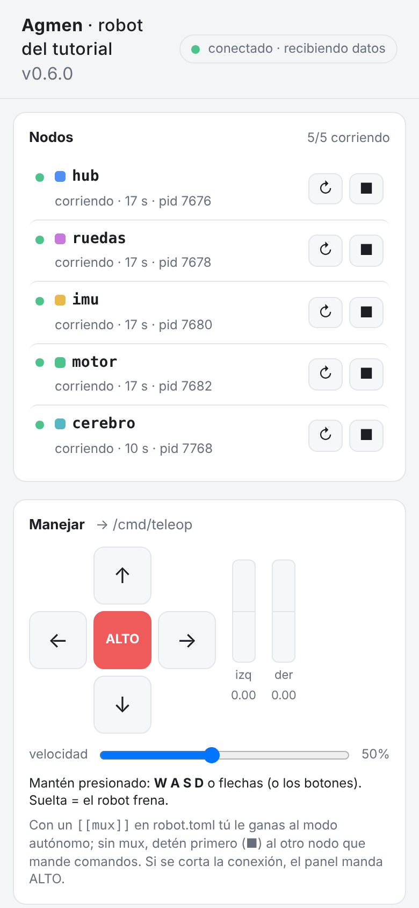

# Capítulo 10 — El panel: varias gráficas, el inspector, tu celular y Foxglove

*Disponible desde Agmen 0.6.0 · ⏱ 15 minutos*

Desde Agmen 0.6 el panel habla con el robot por un **WebSocket**: una sola
conexión que va en los dos sentidos. Lo importante es **qué** viaja por ella:

```
 robot                                   navegador
 nodos ──► agmen run (puente) ──────────► agmen.js decodifica
           solo copia bytes de Agmen      y dibuja
```

El robot no convierte nada a JSON ni dibuja nada: le manda al navegador **los
mismos bytes** que se mandan los nodos entre ellos, y el navegador los
decodifica con `agmen.js`. Es la tercera implementación del formato (C++,
Python y JavaScript), y las tres pasan los mismos vectores de prueba.

## 1. Varias gráficas a la vez y el inspector

```bash
agmen run examples/tutorial/robot.toml
```

En el panel, prende el **cerebro** (▶). Arriba de las gráficas aparecen los
topics con su tipo y su frecuencia:


- **Clic en un topic** = graficarlo. Puedes ver varios a la vez: prueba
  `/imu` y `/cmd`, el sensor y los comandos que le llegan al motor.
- El topic con el **borde azul** es el que se muestra en las tarjetas y en el
  **inspector** (abajo). Clic en otro topic graficado para cambiar el foco;
  clic otra vez en el que tiene el foco para quitar su gráfica.
- **Mensaje (inspector):** el último mensaje, campo por campo, con su número
  de secuencia, quién lo mandó, la hora y cuántos bytes ocupa. **Congelar**
  lo detiene para leerlo con calma.
- **CPU del panel:** lo que le cuesta al robot el panel. Con el robot del
  tutorial son unos pocos %.

🧪 Maneja con **W A S D** mientras miras `/cmd` en el inspector: ves cómo
cambia `left` y `right`, y en los logs, cómo el mux le da el mando a
`teleop` y se lo regresa a `cerebro` al soltar.

## 2. Desde tu celular

Con la computadora y el celular **en la misma red WiFi**:

```bash
agmen run examples/tutorial/robot.toml --red
```

La terminal te da el link:

```
agmen   │ panel web: http://127.0.0.1:8080/?t=5qb9IHV2pAIk
agmen   │ panel en tu red (celular, otra laptop): http://192.168.1.20:8080/?t=5qb9IHV2pAIk
agmen   │   ⚠ el link lleva la clave: compártelo solo con quien deba ver y manejar el robot
```

Abre el segundo link en el celular y maneja con los botones.



- El final del link (`?t=…`) es la **clave**. Sin ella, el panel responde
  "Falta la clave" y no deja ver ni manejar nada. Así nadie más en el WiFi de
  la escuela o de la competencia puede mover tu robot.
- Cada vez que arrancas se genera una clave nueva. Si quieres una fija (para
  no copiar el link cada vez), ponla en tu `robot.toml`:

  ```toml
  [web]
  token = "una-clave-larga-que-solo-tu-sepas"
  ```

- En tu propia computadora (`127.0.0.1`, sin `--red`) no se pide clave.
- 💡 **Windows:** la primera vez que usas `--red`, el firewall pregunta si
  Python puede usar la red. Permítelo en **redes privadas** (la de tu casa
  o el laboratorio); si no, el celular no lo encuentra. Sin `--red` no
  pregunta nada, porque el panel no sale de tu computadora.

🧪 **Hombre muerto.** Maneja desde el celular, mantén presionado ↑ y **apaga
el WiFi del celular**. En menos de medio segundo la terminal dice:

```
agmen   │ panel: sin comandos del navegador en 300 ms (192.168.1.31) mientras manejaba → ALTO
```

El panel manda ALTO por ti. Y si eso fallara, el motor tiene su propio freno
por timeout (capítulo 2): dos capas de seguridad.

⚠ La clave viaja sin cifrar: sirve para la red del laboratorio, no para
internet. El acceso desde internet (con usuarios y cifrado) es el modo nube
del nivel 11.

## 3. Foxglove

[Foxglove](https://foxglove.dev) es un visualizador de robótica muy usado con
ROS. Agmen habla su protocolo, así que puedes usarlo para lo que el panel
todavía no tiene (por ejemplo, armar tus propios layouts de gráficas).

1. Instala la app de escritorio de Foxglove (o usa la versión web). Pide
   crear una cuenta; para estudiantes es gratis.
2. Con tu robot corriendo, elige **Open connection → Foxglove WebSocket** y
   escribe `ws://127.0.0.1:8080/ws`. La terminal también te lo dice:
   `Foxglove (solo ver): conéctate a ws://127.0.0.1:8080/ws`.
3. Agrega un panel **Plot** y escribe `/imu.az`, o un panel **Raw Messages**
   con `/cmd`.

Notas:

- Es **solo para ver**: desde Foxglove no se manda nada al robot (todavía).
- Foxglove no entiende el formato compacto de Agmen, así que el puente le
  convierte los mensajes a JSON, **solo a él**. Tu panel sigue recibiendo
  bytes.
- Desde la versión web de Foxglove, el navegador solo te deja conectar a tu
  propia computadora. Para ver un robot en otra máquina usa la app de
  escritorio con el link de `--red` (`ws://192.168.1.20:8080/ws?t=…`).
- [Lichtblick](https://github.com/lichtblick-suite/lichtblick) es una versión
  libre de Foxglove Studio y funciona igual.

## 4. Habla con el puente tú mismo

El panel no tiene nada de magia: cualquier programa puede hacer lo mismo que
el navegador. Con el robot corriendo:

```bash
python3 examples/tutorial/mirar_panel.py --topic /imu --hz 2
```

```
conectado a Agmen 0.6.0 · robot 'robot del tutorial'
anuncio: /imu es agmen/1 ImuSample{f32 ax;f32 ay;f32 az;f32 gx;f32 gy;f32 gz}
seq   5203 · 88 bytes · {'ax': 0.31, 'ay': -0.38, 'az': 9.81, 'gx': 0.0, 'gy': 0.0, 'gz': 0.14}
seq   5253 · 88 bytes · {'ax': -0.46, 'ay': -0.19, 'az': 9.81, 'gx': 0.0, 'gy': 0.0, 'gz': 0.12}
```

- Pide `/imu` a **2 por segundo** (`max_hz`). El sensor publica a 100 Hz, así
  que el puente le manda 1 de cada 50: la `seq` salta de 50 en 50. Cada
  cliente pide lo suyo; el panel del navegador pide hasta 100 por segundo.
- Lo primero que llega es el **anuncio del esquema**. Con él se decodifica
  todo lo demás, sin saber el tipo de antemano.
- Cada mensaje mide 88 bytes: 64 del sobre y 24 de los 6 `f32`. Son los
  mismos bytes que mandó el publisher de C++.

🧪 Cambia `--topic /imu` por `--topic /cmd` con el cerebro prendido, o
`--hz 0` para recibirlos todos.

## Lo que aprendiste

- El panel recibe los **bytes de Agmen sin convertir** y el navegador los
  decodifica: al robot casi no le cuesta (tarjeta "CPU del panel").
- Puedes graficar **varios topics a la vez** y ver cualquier mensaje campo
  por campo en el **inspector**.
- `--red` abre el panel a tu red **con clave**, y si se corta la señal
  mientras manejas, el panel manda ALTO.
- Foxglove (y Lichtblick) se conectan al mismo panel, en solo lectura.

**Siguiente (Agmen 0.7.0):** defines tus mensajes en un archivo `.agmen` y
Agmen escribe el código de C++ y de Python por ti.
